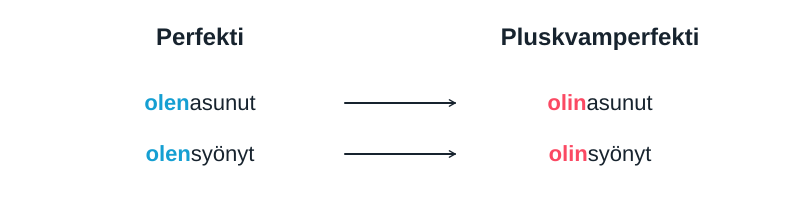

# Как выбрать время в финском {#choosing-tenses}

Конспект по видео Варвары [«Финские времена за 20 минут»](https://www.youtube.com/watch?v=K2NGCBXDbcg) и присланным схемам. Объяснения даны по-русски, переводы финских примеров на английском. На любую схему можно нажать, чтобы открыть её в отдельной вкладке.

На шкале **menneisyys** означает past, **nykyhetki** — the present moment, **tulevaisuus** — future. Красный цвет показывает прошлое, оранжевый обозначает сейчас, жёлтый будущее. Голубая стрелка preesens охватывает настоящее и будущее, а градиент perfekti показывает связь прошлого с настоящим.

## Preesens: сейчас и в будущем {#present}

[Фрагмент видео: 05:19–06:57](https://www.youtube.com/watch?v=K2NGCBXDbcg&t=319s).

{ target="_blank" rel="noopener" }

В обычном финском нет отдельной личной формы будущего времени. **Asun** подходит и для «живу», и для «буду жить». Время становится понятным по словам nyt, huomenna, ensi vuonna или из разговора.

| Финский | English |
| --- | --- |
| Asun nyt Suomessa. | I live in Finland now. |
| Asun ensi vuonna Suomessa. | I will live in Finland next year. |
| Syön omenaa. | I am eating an apple. |
| Syön omenan. | I will eat the whole apple. |

В двух последних примерах **syön** остаётся в preesens. **Omenaa** в partitiivi показывает процесс или неограниченное количество; **omenan** в этой конструкции представляет яблоко как целый объект, который будет съеден полностью.

Падеж дополнения помогает понять характер действия, но сам по себе не определяет настоящее или будущее. Например, **Huomenna syön omenaa välipalaksi.** — Tomorrow I will have some apple as a snack. Здесь partitiivi сочетается с будущим благодаря huomenna.

## Imperfekti: рассказ о прошлом {#imperfect}

[Фрагмент видео: 06:57–09:30](https://www.youtube.com/watch?v=K2NGCBXDbcg&t=417s).

{ target="_blank" rel="noopener" }

Imperfekti используют, когда рассказывают о событиях и ситуациях прошлого. Часто есть eilen, viime vuonna или другой указатель времени. Он может быть назван раньше и не повторяться в каждом предложении.

| Финский | English |
| --- | --- |
| Asuin viime vuonna Suomessa. | I lived in Finland last year. |
| Söin omenan. | I ate the whole apple. |
| Söin omenaa, kun puhelin soi. | I was eating an apple when the phone rang. |

Последний пример тоже стоит в imperfekti: это процесс в прошлом, без сообщения о полном результате. Поэтому imperfekti не означает автоматически «довёл действие до конца».

### Утверждение и отрицание {#imperfect-negative}

В утвердительных формах часто виден показатель -i-: **asun → asuin**. Основа может измениться: **syödä → söin**.

В отрицании используется **отрицательный глагол + причастие прошедшего времени**. К форме en нельзя просто добавить основу с -i-.

| Время | Утверждение | Отрицание |
| --- | --- | --- |
| Preesens | asun | en asu |
| Imperfekti | asuin | en asunut |
| Imperfekti, me | asuimme | emme asuneet |

En, et, ei, emme, ette, eivät меняются по лицу. Причастие в единственном числе: **asunut**, во множественном: **asuneet**. У других глаголов встречаются формы **syönyt, tullut, mennyt, purrut, noussut**: окончание не всегда выглядит буквально как -nut.

## Perfekti: связь прошлого с настоящим {#perfect}

**Olla в preesens + причастие прошедшего времени:** olen asunut, olet asunut, on asunut. Для множественного числа: olemme asuneet, olette asuneet, ovat asuneet. В отрицании: en ole asunut, emme ole asuneet.

Для запоминания можно мысленно разобрать **olen syönyt** как «я есть поевший»: вспомогательный глагол задаёт точку отсчёта, а причастие называет предшествующее действие.

В видео разбираются четыре ситуации, в которых полезно выбрать perfekti.

### 1. Началось раньше и продолжается сейчас {#perfect-continuing}

[Фрагмент видео: 09:34–12:18](https://www.youtube.com/watch?v=K2NGCBXDbcg&t=574s).

{ target="_blank" rel="noopener" }

**Olen asunut Suomessa kolme vuotta** описывает проживание, которое началось три года назад и продолжается сейчас. Русское настоящее «живу три года» здесь соответствует финскому perfekti.

| Финский | English |
| --- | --- |
| Olen asunut Suomessa kolme vuotta. | I have lived in Finland for three years. |
| En ole syönyt sokeria kolmeen päivään. | I have not eaten sugar for three days. |
| En ole käynyt Suomessa kolmeen vuoteen. | I have not visited Finland for three years. |

В **kolme vuotta** числительное стоит в основной форме, а существительное после него в partitiivi. Конструкция **kolmeen päivään / kolmeen vuoteen** выражает период, за который действие не происходило: и числительное, и существительное стоят в illatiivi.

Это правило относится именно к такому интервалу отсутствия действия. При обычном отрицании указатель времени не обязательно меняет форму: **En käynyt siellä viime vuonna.** — I did not go there last year. [Подробнее о временных выражениях](https://uusikielemme.fi/finnish-grammar/finnish-cases/interesting-inflection/expressions-of-time-ajanilmaukset).

### 2. Жизненный опыт {#perfect-experience}

[Фрагмент видео: 12:18–13:14](https://www.youtube.com/watch?v=K2NGCBXDbcg&t=738s).

{ target="_blank" rel="noopener" }

Perfekti помогает сказать, что вы что-то уже делали или пока не делали. В центре внимания сам опыт. Для рассказа об отдельном случае с указанием прошлого периода обычно выбирают imperfekti.

| Финский | English |
| --- | --- |
| Olen lukenut tämän kirjan. | I have read this book. |
| En ole lukenut tätä kirjaa. | I have not read this book. |
| Olen käynyt Norjassa. | I have been to Norway. |
| En ole käynyt Norjassa. | I have not been to Norway. |
| Olen syönyt avokadoa. | I have eaten avocado. |
| En ole koskaan syönyt avokadoa. | I have never eaten avocado. |

В отрицании объект **tämän kirjan** меняется на **tätä kirjaa**, то есть получает partitiivi. Это не правило для всех существительных предложения: место **Norjassa** остаётся в прежней форме.

### 3. Результат важен сейчас {#perfect-result}

[Фрагмент видео: 13:17–14:13](https://www.youtube.com/watch?v=K2NGCBXDbcg&t=797s).

{ target="_blank" rel="noopener" }

Если вас приглашают поесть, **olen jo syönyt** может объяснять, почему вы сейчас не голодны. Говорящий связывает прошлую еду с нынешней ситуацией.

| Финский | English |
| --- | --- |
| Söin aamulla. | I ate in the morning. |
| Olen jo syönyt. | I have already eaten. |
| En halua syödä, koska olen jo syönyt. | I do not want to eat because I have already eaten. |

Imperfekti тоже может описывать событие с последствиями. Выбор perfekti показывает, что говорящий специально связывает прошлое с текущей ситуацией. Слова jo и vielä помогают: **jo** — already; **ei vielä** — not yet.

### 4. Завершение перед будущим действием {#perfect-future}

[Фрагмент видео: 14:16–15:13](https://www.youtube.com/watch?v=K2NGCBXDbcg&t=856s).

{ target="_blank" rel="noopener" }

В главной части стоит preesens со значением будущего, а после **kun** используется perfekti. Так подчёркивают: первое действие будет завершено к моменту следующего.

| Финский | English |
| --- | --- |
| Pelaan sinun kanssasi, kun olen tehnyt kotitehtävät. | I will play with you when I have finished my homework. |
| Teen kotitehtävät ja sitten pelaan sinun kanssasi. | I will do my homework and then play with you. |

В первом предложении **olen tehnyt** относится к будущему моменту игры: к тому времени домашнее задание будет сделано. Во втором действия просто перечислены по порядку.

**Kun** здесь означает «когда» и выражает временную связь. Бытовой смысл «сначала домашка, потом игра» возможен, но грамматически это не обязательное условие с «если». Для «если» обычно нужен **jos**. [О временном союзе kun](https://kielikello.fi/sita-mukaa-kun-vai-sita-mukaa-kuin/).

## Pluskvamperfekti: раньше другого прошлого {#pluperfect}

[Фрагмент видео: 15:14–16:25](https://www.youtube.com/watch?v=K2NGCBXDbcg&t=914s).

{ target="_blank" rel="noopener" }

В pluskvamperfekti точкой отсчёта служит момент в прошлом. Другое действие произошло ещё раньше.

Образование: **olla в imperfekti + то же причастие прошедшего времени**. Меняется вспомогательный глагол, apuverbi.

| Время | Asua | Syödä |
| --- | --- | --- |
| Perfekti | olen asunut | olen syönyt |
| Pluskvamperfekti | olin asunut | olin syönyt |

Для остальных лиц: **olit, oli, olimme, olitte, olivat**. Во множественном числе причастие тоже множественное: **olimme asuneet**. Отрицательные формы: **en ollut asunut**, **emme olleet asuneet**.

### Сначала сделал, затем ушёл {#past-sequence}

[Фрагмент видео: 16:27–17:38](https://www.youtube.com/watch?v=K2NGCBXDbcg&t=987s).

{ target="_blank" rel="noopener" }

| Финский | English |
| --- | --- |
| Minä tein tehtävät loppuun ja sitten lähdin kotiin. | I finished the tasks and then went home. |
| Kun olin tehnyt tehtävät loppuun, lähdin kotiin. | When I had finished the tasks, I went home. |

В первом предложении два imperfekti рассказывают о последовательных событиях. Во втором **olin tehnyt** явно помещает завершение заданий раньше **lähdin**. Pluskvamperfekti показывает предшествование; само по себе оно не сообщает, что без первого события второе было бы невозможно.

### Собака ела или уже съела? {#dog-example}

[Фрагмент видео: 17:49–18:43](https://www.youtube.com/watch?v=K2NGCBXDbcg&t=1069s).

{ target="_blank" rel="noopener" }

| Финский | English |
| --- | --- |
| Kun tulin kotiin, koira söi kenkiäni. | When I came home, the dog was eating my shoes. |
| Kun tulin kotiin, koira oli jo syönyt kenkäni. | When I came home, the dog had already eaten my shoes. |

В первом примере действие собаки показано в процессе в момент возвращения. **Kenkiäni** стоит в partitiivi. Во втором действие собаки предшествует возвращению; **jo** и полный объект **kenkäni** дополнительно подчёркивают результат.

Различие создаётся временем, контекстом и формой объекта вместе. Два imperfekti не всегда означают одновременность: в предыдущем примере **tein ... ja sitten lähdin** события идут друг за другом.

## Краткая памятка {#quick-reference}

| Что хотите выразить | Время | Пример |
| --- | --- | --- |
| Сейчас или план на будущее | Preesens | asun / en asu |
| Событие или ситуация прошлого | Imperfekti | asuin / en asunut |
| Опыт, результат сейчас или продолжающаяся ситуация | Perfekti | olen asunut / en ole asunut |
| Что произошло до другого момента в прошлом | Pluskvamperfekti | olin asunut / en ollut asunut |

Сначала определите точку отсчёта: сейчас или момент в прошлом. Затем решите, вы рассказываете о событии, показываете связь с настоящим или помещаете действие раньше другого прошлого события. Завершённость дополнительно проверяйте по контексту и объекту.

## Практика по финалу видео {#practice}

[Фрагмент видео: 20:47–21:27](https://www.youtube.com/watch?v=K2NGCBXDbcg&t=1247s). Переведите на финский. Формулировки заданий даны на английском; варианты ответов составлены для этой страницы.

1. I will wash my hands and then eat.
2. When I have washed my hands, I will go and eat.
3. Yesterday, while I was watching television, my grandmother called me.
4. Yesterday, after I had watched television, my grandmother called me.
5. I have been to Paris many times.
6. I was in Paris three years ago.

??? note "Показать возможные ответы"

    1. Pesen käteni ja sitten syön.
    2. Kun olen pessyt käteni, menen syömään.
    3. Kun katsoin eilen televisiota, isoäitini soitti minulle.
    4. Kun olin eilen katsonut televisiota, isoäitini soitti minulle.
    5. Olen käynyt Pariisissa monta kertaa.
    6. Olin Pariisissa kolme vuotta sitten.

    В первом ответе два preesens описывают будущие действия. Во втором kun + perfekti показывает завершение мытья перед едой. В третьем действие происходит в момент просмотра; в четвёртом просмотр предшествует звонку. Последняя пара сравнивает опыт и отдельный случай в прошлом.

## Источники и уточнения {#sources}

- [Видео «Финские времена за 20 минут»](https://www.youtube.com/watch?v=K2NGCBXDbcg): основа конспекта, присланного транскрипта и схем.
- [Uusi kielemme: употребление perfekti](https://uusikielemme.fi/finnish-grammar/verbs/verb-tenses-and-moods/the-perfect-tense-perfekti).
- [Uusi kielemme: сравнение imperfekti и perfekti](https://uusikielemme.fi/finnish-grammar/verbs/verb-tenses-and-moods/the-imperfect-and-perfect-tense-examples).
- [Uusi kielemme: pluskvamperfekti](https://uusikielemme.fi/finnish-grammar/verbs/verb-tenses-and-moods/the-plusquamperfect-tense-pluskvamperfekti).
- [Kielitoimiston ohjepankki: притяжательные суффиксы](https://kielitoimistonohjepankki.fi/ohje/omistusliitteet/).

Ошибки распознавания исправлены по скриншотам: **asuin, söin, tein, lähdin, olin tehnyt**. Примеры приведены к стандартному финскому: **sinun kanssasi**, **kenkiäni**, **kenkäni**. Пояснения о завершённости, временных интервалах и kun уточняют упрощённые формулировки видео.

[На главную](../index.md).
