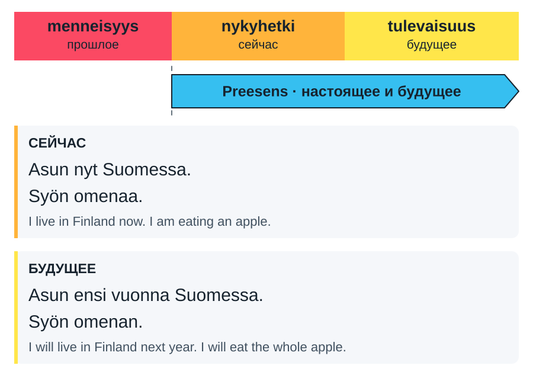
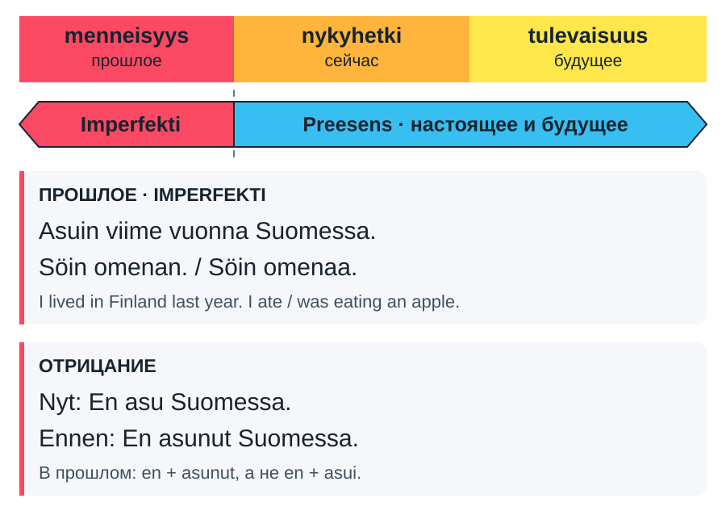
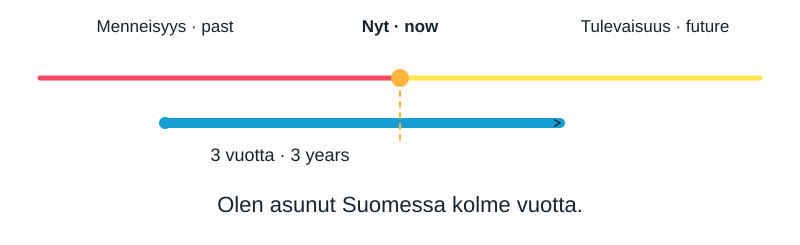
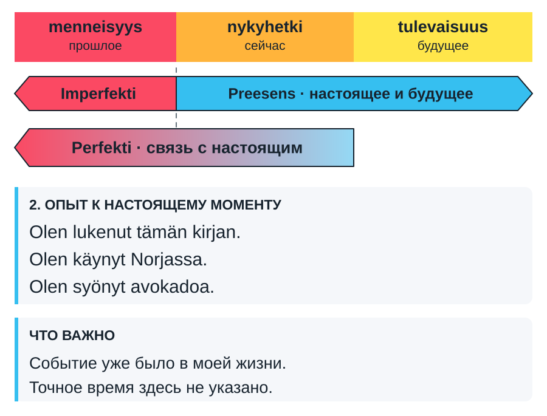
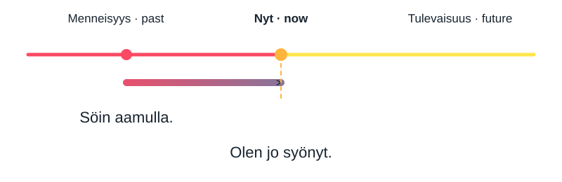
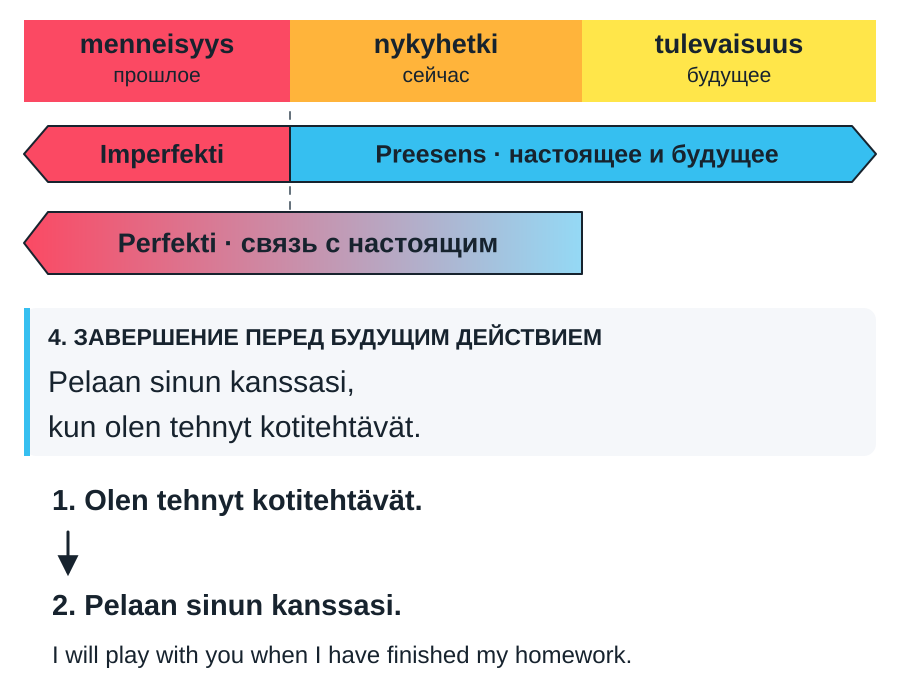
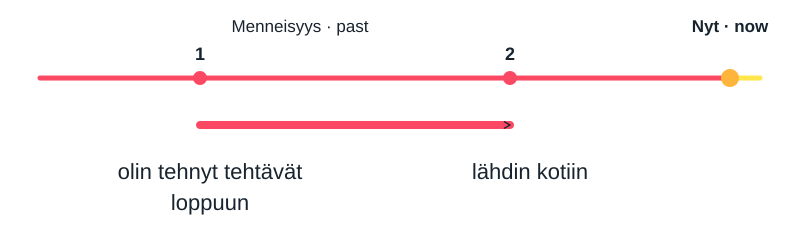
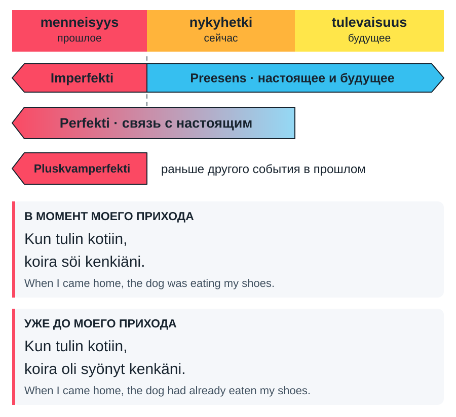

# Времена финского глагола {#choosing-tenses}

Здесь собраны правила выбора четырёх времён: **preesens, imperfekti, perfekti, pluskvamperfekti**.

## Preesens: настоящее и будущее {#present}

### Когда использовать {#present-use}

Preesens описывает то, что происходит сейчас, повторяется или планируется на будущее. Отдельной обычной формы будущего времени в финском нет. Значение помогают определить слова **nyt** (now), **huomenna** (tomorrow), **ensi vuonna** (next year) и контекст.

{ target="\_blank" rel="noopener" }

| Финский                    | English                           |
| -------------------------- | --------------------------------- |
| Asun nyt Suomessa.         | I live in Finland now.            |
| Asun ensi vuonna Suomessa. | I will live in Finland next year. |
| Käyn kaupassa joka päivä.  | I go to the shop every day.       |

### Как образовать {#present-forms}

| Verbityyppi | Sana                                    | Positiivinen       | Negatiivinen         |
| ----------- | --------------------------------------- | ------------------ | -------------------- |
| 1           | katsoa ⇒ katso- ⇒ katso**n**            | minä katso**n**    | minä **en** katso    |
| 2           | syödä ⇒ syö- ⇒ syö**n**                 | minä syö**n**      | sinä **et** syö      |
| 3           | mennä ⇒ men**e**- ⇒ mene**n**           | minä men**en**     | hän **ei** mene      |
| 4           | haluta ⇒ halu**a**- ⇒ halua**n**        | minä halu**an**    | me **emme** halua    |
| 5           | tarvita ⇒ tarvi**tse**- ⇒ tarvitse**n** | minä tarvi**tsen** | te **ette** tarvitse |
| 6           | tarjeta ⇒ tarke**ne**- ⇒ tarkene**n**   | minä tarke**nen**  | he **eivät** tarkene |

## Imperfekti: события в прошлом {#imperfect}

### Когда использовать {#imperfect-use}

Выбирайте imperfekti, когда рассказываете о прошлом событии или периоде. Время часто уточняют словами **eilen** (yesterday), **viime vuonna** (last year). Оно также может быть понятно из предыдущих фраз.

{ target="\_blank" rel="noopener" }

| Финский                       | English                                    |
| ----------------------------- | ------------------------------------------ |
| Asuin Suomessa viime vuonna.  | I lived in Finland last year.              |
| Söin aamulla.                 | I ate in the morning.                      |
| Söin omenaa, kun puhelin soi. | I was eating an apple when the phone rang. |

Imperfekti не означает автоматически, что действие доведено до результата. В последнем примере человек ел яблоко; предложение не сообщает, что он съел его целиком.

### Как образовать {#imperfect-forms}

| Sääntö     | Sana    | Positivinen                          | Negativinen       |
| ---------- | ------- | ------------------------------------ | ----------------- |
| o, ö, u, y | sanoa   | minä san**o**- minä sano**i**n       | minä en sanonut   |
| a, ä, e, i | odottaa | minä odot**a**- minä odot**i**n      | minä ei sanonut   |
| a--a       | laula   | minä l**a**ul**a**- minä laul**oi**n | hän ei sanonut    |
| VV         | juoda   | minä j**uo**- minä j**oi**n          | me emme saoneet   |
| VT 4 + 1   | herätää | minä **herää**- minä herä**si**n     | te ette sanoneet  |
|            |         |                                      | he eivät sanoneet |

## Perfekti: связь с настоящим {#perfect}

### Когда использовать и как образовать {#perfect-forms}

**Perfekti** показывает действие, которое произошло в прошлом, но связано с настоящим: важен его результат, полученный опыт или то, что действие продолжается до сих пор. Точное время обычно не указывается.

| Verbityyppi | Sana                                                                                   | Positiivinen                                                                                                  | Negatiivinen                                                                                                          |
| ----------- | -------------------------------------------------------------------------------------- | ------------------------------------------------------------------------------------------------------------- | --------------------------------------------------------------------------------------------------------------------- |
| 1           | sanoa ⇒ sano**nut** kysyä ⇒ kysy**nyt**                                             | minä **olen** sano**nut** minä **olen** kysy**nyt**                                                        | minä **en ole** sano**nut** minä **en ole** kysy**nyt**                                                            |
| 2           | juoda ⇒ juo**nut** syödä ⇒ syö**nyt**                                               | minä **olen** juo**nut** minä **olen** syö**nyt**                                                          | minä **en ole** juo**nut** minä **en ole** syö**nyt**                                                              |
| 3           | mennä ⇒ men**nyt** tulla ⇒ tul**lut** purra ⇒ pur**rut** nousta ⇒ nous**sut** | minä **olen** me**nnyt** minä **olen** tu**llut** minä **olen** pu**rrut** minä **olen** nou**ssut** | minä **en ole** me**nnyt** minä **en ole** tu**llut** minä **en ole** pu**rrut** minä **en ole** nou**ssut** |
| 4           | haluta ⇒ halu**nnut** herätä ⇒ herä**nnyt**                                         | minä **olen** halu**nnut** minä **olen** herä**nnyt**                                                      | minä **en ole** halu**nnut** minä **en ole** herä**nnyt**                                                          |
| 5           | tarvita ⇒ tarvi**nnut** häiritä ⇒ häiri**nnyt**                                     | minä **olen** tarvi**nnut** minä **olen** häiri**nnyt**                                                    | minä **en ole** tarvi**nnut** minä **en ole** häiri**nnyt**                                                        |
| 6           | tarjeta ⇒ tarje**nnut** lyhetä ⇒ lyhe**nnyt**                                       | minä **olen** tarje**nnut** minä **olen** lyhe**nnyt**                                                     | minä **en ole** tarje**nnut** minä **en ole** lyhe**nnyt**                                                         |

| Лицо | Positiivinen               | Negatiivinen                  |
| ---- | -------------------------- | ----------------------------- |
| minä | minä **olen** sano**nut**  | minä **en ole** sano**nut**   |
| sinä | sinä **olet** sano**nut**  | sinä **et ole** sano**nut**   |
| hän  | hän **on** sano**nut**     | hän **ei ole** sano**nut**    |
| me   | me **olemme** sano**neet** | me **emme ole** sano**neet**  |
| te   | te **olette** sano**neet** | te **ette ole** sano**neet**  |
| he   | he **ovat** sano**neet**   | he **eivät ole** sano**neet** |

### Началось раньше и продолжается {#perfect-continuing}

Действие или состояние началось в прошлом и сохраняется сейчас. В примере с asua человек по-прежнему живёт в Финляндии.

{ target="\_blank" rel="noopener" }

| Финский                            | English                                  |
| ---------------------------------- | ---------------------------------------- |
| Olen asunut Suomessa kolme vuotta. | I have lived in Finland for three years. |
| Asuin Suomessa kolme vuotta.       | I lived in Finland for three years.      |

Вторая фраза стоит в imperfekti и описывает прошлый период проживания, который уже закончился.

#### Как давно действие не происходило {#negative-duration}

| Финский                                 | English                                     |
| --------------------------------------- | ------------------------------------------- |
| En ole syönyt sokeria kolmeen päivään.  | I have not eaten sugar for three days.      |
| En ole käynyt Suomessa kolmeen vuoteen. | I have not visited Finland for three years. |

**Kolme vuotta** выражает обычную продолжительность: числительное в основной форме, существительное в partitiivi. **Kolmeen päivään / kolmeen vuoteen** выражает интервал отсутствия действия; оба слова стоят в illatiivi.

Это относится именно к такому интервалу. Слова вроде viime vuonna при отрицании остаются без изменений: **En käynyt siellä viime vuonna.** — I did not go there last year.

### Жизненный опыт {#perfect-experience}

Perfekti помогает сообщить, что вы уже делали или пока не делали что-либо. Главное здесь сам опыт к настоящему моменту. Для конкретного случая с указанием прошлого периода обычно выбирают imperfekti.

{ target="\_blank" rel="noopener" }

| Финский                         | English                      |
| ------------------------------- | ---------------------------- |
| Olen käynyt Norjassa.           | I have been to Norway.       |
| En ole koskaan käynyt Norjassa. | I have never been to Norway. |
| Olen lukenut tämän kirjan.      | I have read this book.       |
| En ole lukenut tätä kirjaa.     | I have not read this book.   |
| Olen syönyt avokadoa.           | I have eaten avocado.        |

**Koskaan** в таком отрицательном предложении соответствует never. Формы kirjan и kirjaa разобраны в [разделе об объекте](#objects).

### Результат важен сейчас {#perfect-result}

Выбирайте perfekti, если хотите связать прошлое событие с текущей ситуацией. Например, в ответ на предложение поесть фраза olen jo syönyt объясняет, почему вы сейчас не хотите есть.

{ target="\_blank" rel="noopener" }

| Финский                               | English                                            |
| ------------------------------------- | -------------------------------------------------- |
| Söin aamulla.                         | I ate in the morning.                              |
| Olen jo syönyt.                       | I have already eaten.                              |
| En ole vielä syönyt.                  | I have not eaten yet.                              |
| En halua syödä, koska olen jo syönyt. | I do not want to eat because I have already eaten. |

**Jo** означает already, **ei vielä** — not yet. Imperfekti тоже может описывать событие с последствиями; perfekti делает связь с настоящим частью сообщения.

### Сначала завершить, потом сделать другое {#perfect-future}

В предложении с **kun** (when) perfekti может показывать, что первое действие будет завершено к моменту следующего будущего действия. В главной части стоит preesens со значением будущего.

{ target="\_blank" rel="noopener" }

| Финский                                              | English                                                |
| ---------------------------------------------------- | ------------------------------------------------------ |
| Pelaan sinun kanssasi, kun olen tehnyt kotitehtävät. | I will play with you when I have finished my homework. |
| Teen kotitehtävät ja sitten pelaan sinun kanssasi.   | I will do my homework and then play with you.          |

В первом предложении к моменту игры домашнее задание будет сделано. Во втором действия перечислены по порядку; **sitten** означает then.

**Kun** здесь выражает время: «когда». Смысл «сначала домашка, потом игра» возможен, но это не грамматическое условие с «если»; для «если» обычно нужен **jos** (if).

## Pluskvamperfekti: прошлое до прошлого {#pluperfect}

### Когда использовать и как образовать {#pluperfect-forms}

Выберите момент в прошлом. Pluskvamperfekti показывает действие, которое произошло ещё раньше этого момента.

| Verbityyppi | Sana                                                                                   | Positiivinen                                                                                                  | Negatiivinen                                                                                                                  |
| ----------- | -------------------------------------------------------------------------------------- | ------------------------------------------------------------------------------------------------------------- | ----------------------------------------------------------------------------------------------------------------------------- |
| 1           | sanoa ⇒ sano**nut** kysyä ⇒ kysy**nyt**                                             | minä **olin** sano**nut** minä **olin** kysy**nyt**                                                        | minä **en ollut** sano**nut** minä **en ollut** kysy**nyt**                                                                |
| 2           | juoda ⇒ juo**nut** syödä ⇒ syö**nyt**                                               | minä **olin** juo**nut** minä **olin** syö**nyt**                                                          | minä **en ollut** juo**nut** minä **en ollut** syö**nyt**                                                                  |
| 3           | mennä ⇒ me**nnyt** tulla ⇒ tu**llut** purra ⇒ pu**rrut** nousta ⇒ nou**ssut** | minä **olin** me**nnyt** minä **olin** tu**llut** minä **olin** pu**rrut** minä **olin** nou**ssut** | minä **en ollut** me**nnyt** minä **en ollut** tu**llut** minä **en ollut** pu**rrut** minä **en ollut** nou**ssut** |
| 4           | haluta ⇒ halu**nnut** herätä ⇒ herä**nnyt**                                         | minä **olin** halu**nnut** minä **olin** herä**nnyt**                                                      | minä **en ollut** halu**nnut** minä **en ollut** herä**nnyt**                                                              |
| 5           | tarvita ⇒ tarvi**nnut** häiritä ⇒ häiri**nnyt**                                     | minä **olin** tarvi**nnut** minä **olin** häiri**nnyt**                                                    | minä **en ollut** tarvi**nnut** minä **en ollut** häiri**nnyt**                                                            |
| 6           | tarjeta ⇒ tarje**nnut** lyhetä ⇒ lyhe**nnyt**                                       | minä **olin** tarje**nnut** minä **olin** lyhe**nnyt**                                                     | minä **en ollut** tarje**nnut** minä **en ollut** lyhe**nnyt**                                                             |

| Лицо | Positiivinen           | Negatiivinen                 |
| ---- | ---------------------- | ---------------------------- |
| minä | minä **olin** sanonut  | minä **en ollut** sanonut    |
| sinä | sinä **olit** sanonut  | sinä **et ollut** sanonut    |
| hän  | hän **oli** sanonut    | hän **ei ollut** sanonut     |
| me   | me **olimme** sanoneet | me **emme olleet** sanoneet  |
| te   | te **olitte** sanoneet | te **ette olleet** sanoneet  |
| he   | he **olivat** sanoneet | he **eivät olleet** sanoneet |

### Порядок событий в прошлом {#past-sequence}

{ target="\_blank" rel="noopener" }

| Финский                                             | English                                     |
| --------------------------------------------------- | ------------------------------------------- |
| Minä tein tehtävät loppuun ja sitten lähdin kotiin. | I finished the tasks and then went home.    |
| Kun olin tehnyt tehtävät loppuun, lähdin kotiin.    | When I had finished the tasks, I went home. |

Два imperfekti в первой фразе рассказывают о событиях по порядку. Во второй **olin tehnyt** прямо указывает на более раннее действие. Pluskvamperfekti показывает предшествование, но само по себе не означает, что второе событие без первого было бы невозможно.

### Одновременно или раньше {#dog-example}

{ target="\_blank" rel="noopener" }

| Финский                                        | English                                               |
| ---------------------------------------------- | ----------------------------------------------------- |
| Kun tulin kotiin, koira söi kenkiäni.          | When I came home, the dog was eating my shoes.        |
| Kun tulin kotiin, koira oli jo syönyt kenkäni. | When I came home, the dog had already eaten my shoes. |

В первом примере собака показана в процессе еды в момент возвращения. Во втором она съела обувь до возвращения. Контраст усиливают **partitiivi kenkiäni** и **полный объект kenkäni**.

Два imperfekti не всегда означают одновременность: **tein ... ja sitten lähdin** выше описывает последовательность. Смотрите на союз, объект и весь контекст.

## Что показывает форма объекта {#objects}

**Время глагола** показывает отношение к моменту речи или другой точке отсчёта. **Падеж объекта** помогает показать процесс, количество и полный результат. Эти признаки работают вместе.

| Финский                           | English                                     |
| --------------------------------- | ------------------------------------------- |
| Syön omenaa.                      | I am eating an apple.                       |
| Syön omenan.                      | I will eat the whole apple.                 |
| Huomenna syön omenaa välipalaksi. | Tomorrow I will have some apple as a snack. |
| Söin omenaa, kun puhelin soi.     | I was eating an apple when the phone rang.  |
| Söin omenan.                      | I ate the whole apple.                      |

**Omenaa** стоит в partitiivi и в этих примерах показывает процесс или часть количества. **Omenan** представляет яблоко как целый объект, который будет или был съеден полностью. Окончание объекта само по себе не выбирает настоящее или будущее: в третьей строке omenaa сочетается с будущим благодаря huomenna.

При отрицании объект обычно получает partitiivi: **olen lukenut tämän kirjan** (I have read this book) → **en ole lukenut tätä kirjaa** (I have not read this book). Это правило для объекта, а не для всех существительных: **Norjassa** (in Norway) сохраняет свою форму.

## Как задавать вопросы {#questions}

### Вопросы «да/нет» {#yes-no-questions}

Поставьте личную форму глагола первой и добавьте **-ko/-kö**. В perfekti и pluskvamperfekti вопрос начинается со вспомогательного olla: oletko, olitko. Частица выбирается по гармонии гласных: **asutko**, но **syötkö**.

| Время            | Финский                                        | English                                           |
| ---------------- | ---------------------------------------------- | ------------------------------------------------- |
| Preesens         | Asutko Suomessa?                               | Do you live in Finland?                           |
| Imperfekti       | Asuitko Suomessa viime vuonna?                 | Did you live in Finland last year?                |
| Perfekti         | Oletko asunut Suomessa?                        | Have you lived in Finland?                        |
| Pluskvamperfekti | Olitko asunut Suomessa ennen muuttoa Ruotsiin? | Had you lived in Finland before moving to Sweden? |

В отрицательном вопросе **-kö** присоединяется к отрицательному глаголу:

| Финский                                   | English                                      |
| ----------------------------------------- | -------------------------------------------- |
| Etkö asu Suomessa?                        | Don't you live in Finland?                   |
| Etkö asunut Suomessa?                     | Didn't you live in Finland?                  |
| Etkö ole asunut Suomessa?                 | Haven't you lived in Finland?                |
| Etkö ollut asunut Suomessa ennen muuttoa? | Hadn't you lived in Finland before the move? |

### Вопросительное слово {#question-words}

Если есть **missä** (where), **milloin** (when), **mitä** (what) или **miksi** (why), начните с него. В обычных вопросах такого типа -ko/-kö не добавляется.

| Финский                          | English                               |
| -------------------------------- | ------------------------------------- |
| Missä asut?                      | Where do you live?                    |
| Milloin muutit Suomeen?          | When did you move to Finland?         |
| Mitä olet tehnyt tänään?         | What have you done today?             |
| Mitä olit tehnyt ennen kokousta? | What had you done before the meeting? |

## Практика: выберите подходящее время {#practice}

Переведите на финский. Это шесть заданий из финала видео, сформулированных на английском. Варианты ответов составлены для справочника.

1. I will wash my hands and then eat.
2. When I have washed my hands, I will go and eat.
3. Yesterday, while I was watching television, my grandmother called me.
4. Yesterday, after I had watched television, my grandmother called me.
5. I have been to Paris many times.
6. I was in Paris three years ago.

??? note "Показать ответы и объяснение выбора"

    1. **Pesen käteni ja sitten syön.** Два preesens описывают будущие действия.
    2. **Kun olen pessyt käteni, menen syömään.** Perfekti показывает, что мытьё будет завершено перед едой.
    3. **Kun katsoin eilen televisiota, isoäitini soitti minulle.** Просмотр происходил в момент звонка.
    4. **Kun olin eilen katsonut televisiota, isoäitini soitti minulle.** Просмотр предшествовал звонку.
    5. **Olen käynyt Pariisissa monta kertaa.** Опыт к настоящему моменту.
    6. **Olin Pariisissa kolme vuotta sitten.** Отдельный случай в прошлом.

## Видео и источники {#sources}

Основой справочника служат присланные видео, транскрипт и схемы. В примерах исправлены ошибки распознавания; используются стандартные формы sinun kanssasi, kenkiäni и kenkäni. Схемы можно открыть отдельно нажатием на изображение.

| Фрагмент видео                                                     | Тема                                 |
| ------------------------------------------------------------------ | ------------------------------------ |
| [05:19–06:57](https://www.youtube.com/watch?v=K2NGCBXDbcg&t=319s)  | Preesens                             |
| [06:57–09:30](https://www.youtube.com/watch?v=K2NGCBXDbcg&t=417s)  | Imperfekti                           |
| [09:34–15:13](https://www.youtube.com/watch?v=K2NGCBXDbcg&t=574s)  | Четыре употребления perfekti         |
| [15:14–18:43](https://www.youtube.com/watch?v=K2NGCBXDbcg&t=914s)  | Pluskvamperfekti и сравнение событий |
| [20:47–21:27](https://www.youtube.com/watch?v=K2NGCBXDbcg&t=1247s) | Практика                             |

- [Видео Варвары «Финские времена за 20 минут»](https://www.youtube.com/watch?v=K2NGCBXDbcg).
- [Uusi kielemme: употребление perfekti](https://uusikielemme.fi/finnish-grammar/verbs/verb-tenses-and-moods/the-perfect-tense-perfekti).
- [Uusi kielemme: сравнение imperfekti и perfekti](https://uusikielemme.fi/finnish-grammar/verbs/verb-tenses-and-moods/the-imperfect-and-perfect-tense-examples).
- [Uusi kielemme: pluskvamperfekti](https://uusikielemme.fi/finnish-grammar/verbs/verb-tenses-and-moods/the-plusquamperfect-tense-pluskvamperfekti).
- [Uusi kielemme: временные выражения](https://uusikielemme.fi/finnish-grammar/finnish-cases/interesting-inflection/expressions-of-time-ajanilmaukset).
- [Uusi kielemme: построение вопросов](https://uusikielemme.fi/finnish-grammar/syntax/sentence-types/kysymyslause-making-questions-in-finnish-lausetyypit).
- [Kielitoimiston ohjepankki: вежливое обращение на te](https://kielitoimistonohjepankki.fi/ohje/teitittely-oletteko-kokeillut-tata/).

[На главную](../index.md).
