# Suomen mestari правила по темам

## Произношение и гармония гласных {#sounds}

<h3>Vokaalit гласные</h3>

<figure class="grammar-image" markdown="1">

[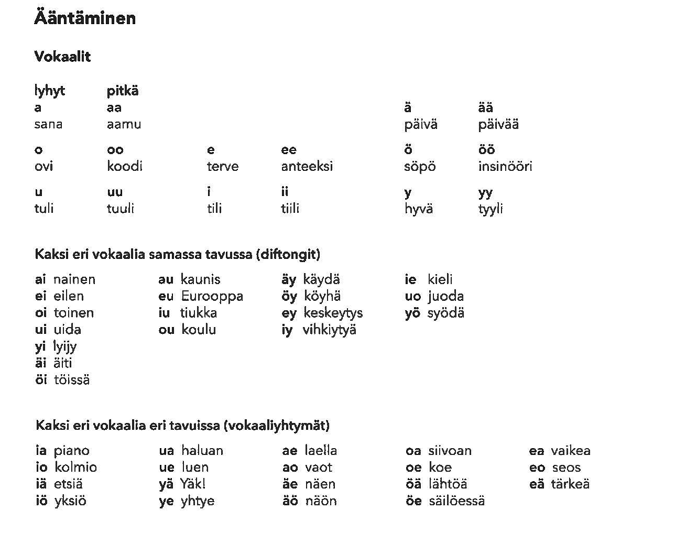{ loading=lazy decoding=async width="1330" height="1036" }](../assets/grammar/sounds/sm1-p01-001.png)

<figcaption>Suomen mestari 1 · s. 310</figcaption>
</figure>

<h3>Konsonantit согласные</h3>

<figure class="grammar-image" markdown="1">

[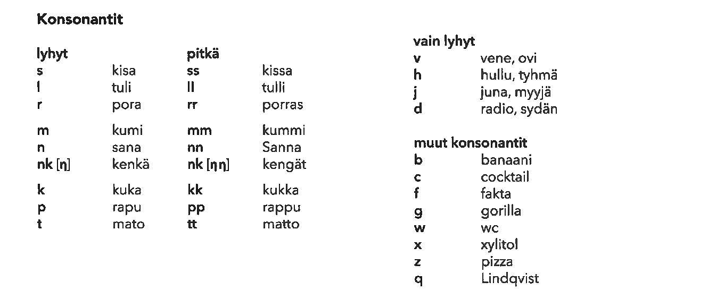{ loading=lazy decoding=async width="1330" height="578" }](../assets/grammar/sounds/sm1-p01-002.png)

<figcaption>Suomen mestari 1 · s. 310</figcaption>
</figure>

<h3>Sanapaino ударение</h3>

<figure class="grammar-image" markdown="1">

[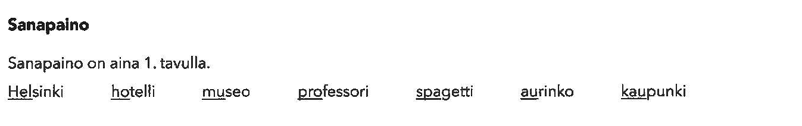{ loading=lazy decoding=async width="1347" height="212" }](../assets/grammar/sounds/sm1-p02-003.png)

<figcaption>Suomen mestari 1 · s. 311</figcaption>
</figure>

<h3>Intonaatio интонация</h3>

<figure class="grammar-image" markdown="1">

[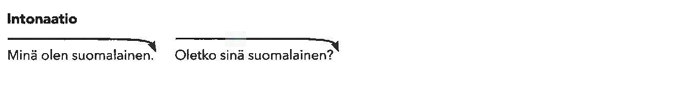{ loading=lazy decoding=async width="1347" height="182" }](../assets/grammar/sounds/sm1-p02-004.png)

<figcaption>Suomen mestari 1 · s. 311</figcaption>
</figure>

<h3>Vokaaliharmonia гармония гласных</h3>

<figure class="grammar-image" markdown="1">

[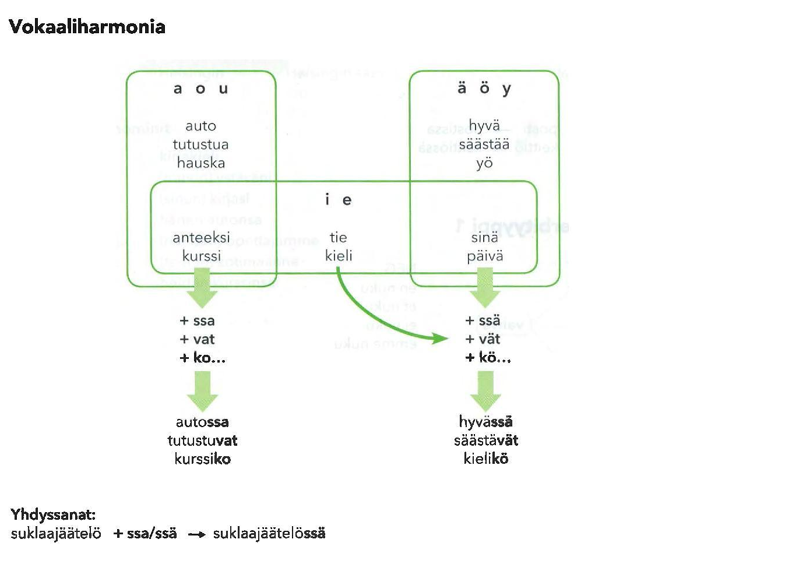{ loading=lazy decoding=async width="1347" height="992" }](../assets/grammar/sounds/sm1-p02-005.png)

<figcaption>Suomen mestari 1 · s. 311</figcaption>
</figure>

## K-p-t-vaihtelu чередование согласных {#kpt}

<h3>K-p-t-vaihtelu</h3>

<figure class="grammar-image" markdown="1">

[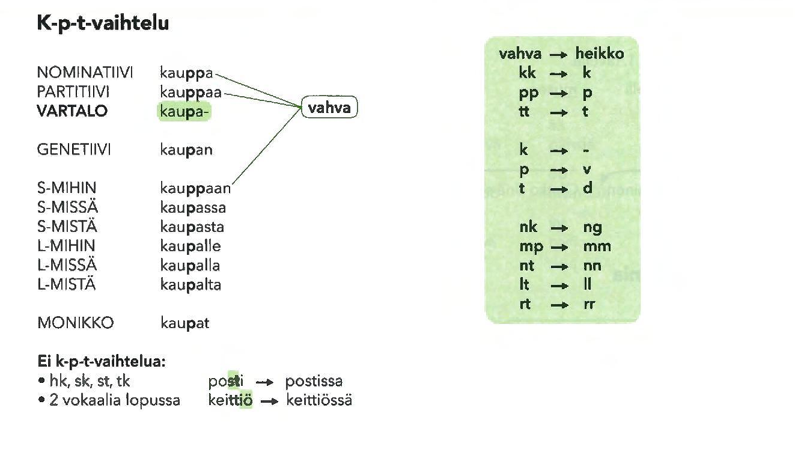{ loading=lazy decoding=async width="1323" height="757" }](../assets/grammar/kpt/sm1-p03-006.png)

<figcaption>Suomen mestari 1 · s. 312</figcaption>
</figure>

<h3>K-p-t-vaihtelu: yksikkö ja monikko</h3>

<figure class="grammar-image" markdown="1">

[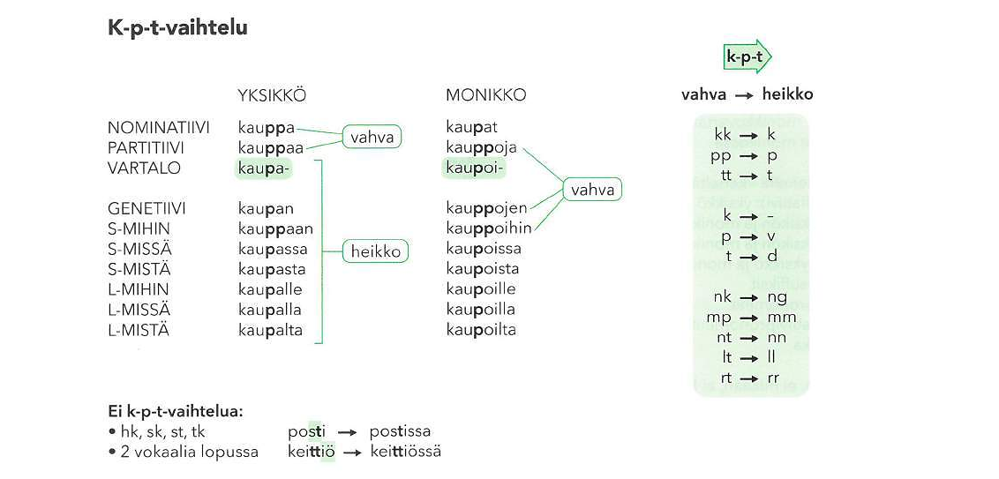{ loading=lazy decoding=async width="1132" height="543" }](../assets/grammar/kpt/sm2-p02-053.png)

<figcaption>Suomen mestari 2 · s. 298</figcaption>
</figure>

<h3>K-p-t-vaihtelu sanatyypeissä e, in, as/äs</h3>

<figure class="grammar-image" markdown="1">

[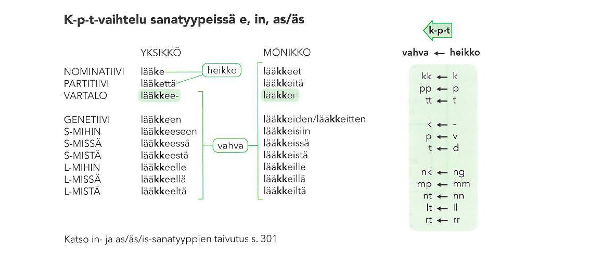{ loading=lazy decoding=async width="1132" height="505" }](../assets/grammar/kpt/sm2-p02-054.png)

<figcaption>Suomen mestari 2 · s. 298</figcaption>
</figure>

<h3>K-p-t-vaihtelu: verbityyppi 1</h3>

<figure class="grammar-image" markdown="1">

[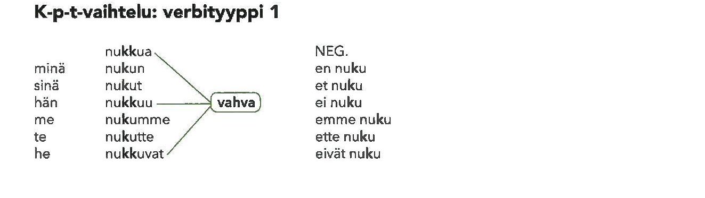{ loading=lazy decoding=async width="1323" height="373" }](../assets/grammar/kpt/sm1-p03-007.png)

<figcaption>Suomen mestari 1 · s. 312</figcaption>
</figure>

<h3>K-p-t-vaihtelu: verbityypit 3 ja 4</h3>

<figure class="grammar-image" markdown="1">

[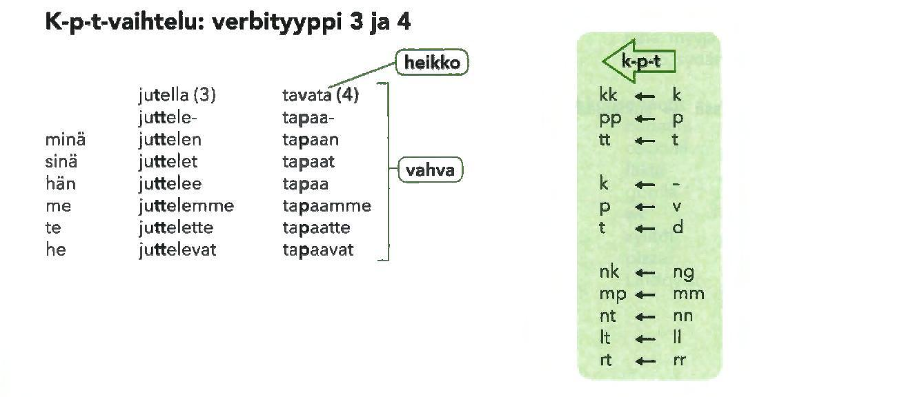{ loading=lazy decoding=async width="1323" height="576" }](../assets/grammar/kpt/sm1-p03-008.png)

<figcaption>Suomen mestari 1 · s. 312</figcaption>
</figure>

<h3>K-p-t-vaihtelu: verbityypit 3, 4, 6</h3>

<figure class="grammar-image" markdown="1">

[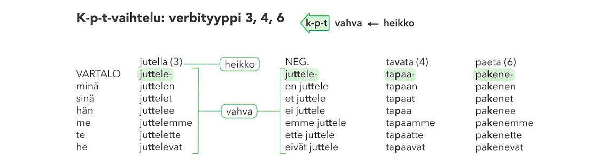{ loading=lazy decoding=async width="1132" height="314" }](../assets/grammar/kpt/sm2-p03-056.png)

<figcaption>Suomen mestari 2 · s. 299</figcaption>
</figure>

<h3>K-p-t-vaihtelu: uku/yky, lki/rki</h3>

<figure class="grammar-image" markdown="1">

[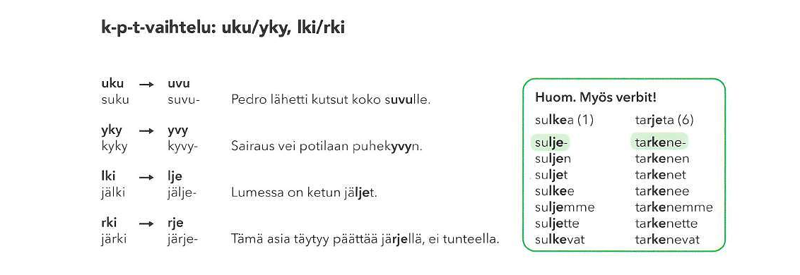{ loading=lazy decoding=async width="1132" height="390" }](../assets/grammar/kpt/sm2-p03-057.png)

<figcaption>Suomen mestari 2 · s. 299</figcaption>
</figure>

## Sanatyypit типы слов {#sanatyypit}

<h3>Sanatyypit: e, nen, i, si, us/ys/os/ös/es</h3>

<figure class="grammar-image" markdown="1">

[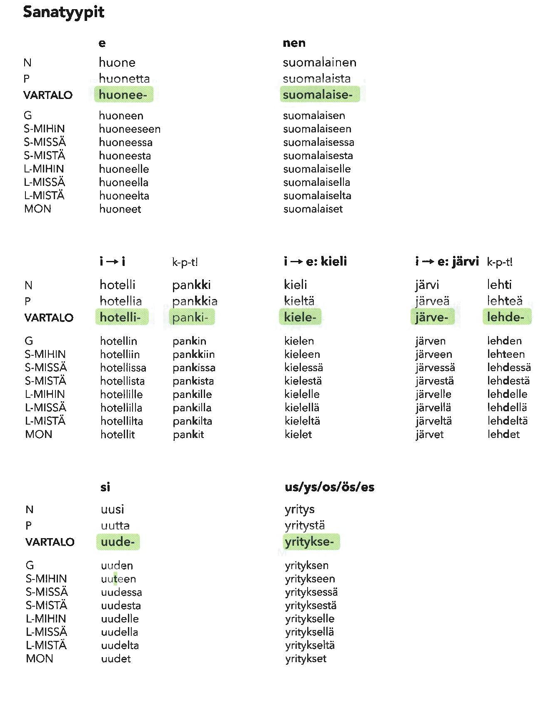{ loading=lazy decoding=async width="1322" height="1691" }](../assets/grammar/sanatyypit/sm1-p09-023.png)

<figcaption>Suomen mestari 1 · s. 318</figcaption>
</figure>

<h3>Sanatyypit: i, si, nen, e</h3>

<figure class="grammar-image" markdown="1">

[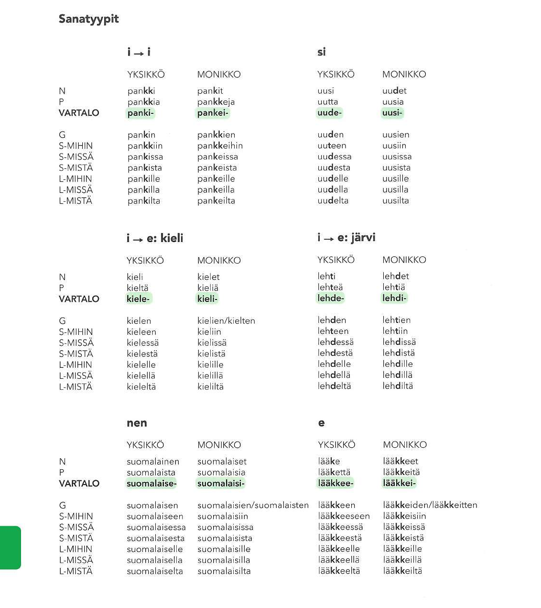{ loading=lazy decoding=async width="1132" height="1271" }](../assets/grammar/sanatyypit/sm2-p04-058.png)

<figcaption>Suomen mestari 2 · s. 300</figcaption>
</figure>

<h3>Sanatyypit: in, as/äs/is, us/ys/os/ös/es, vus/vys, ut/yt, nut/nyt</h3>

<figure class="grammar-image" markdown="1">

[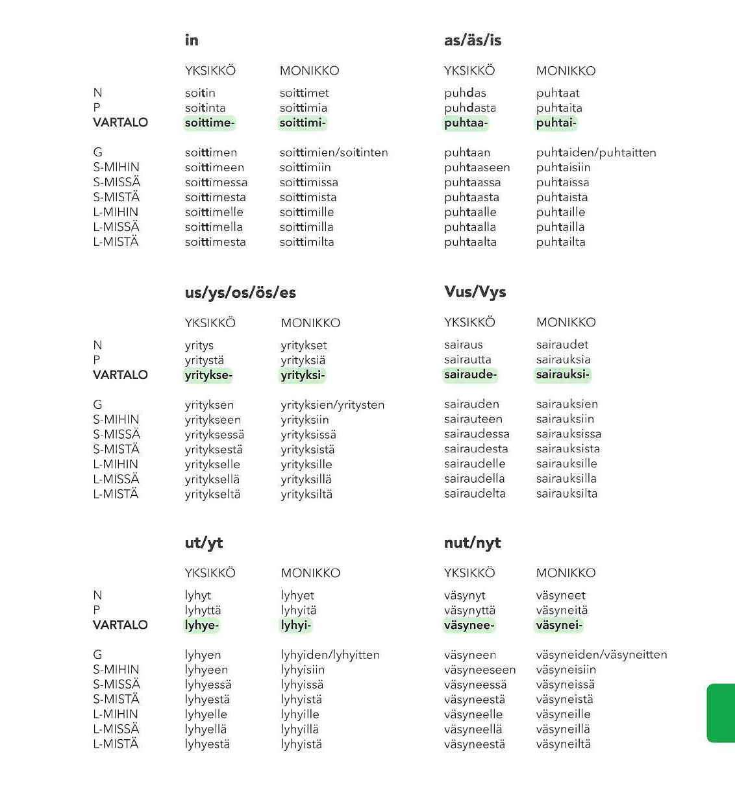{ loading=lazy decoding=async width="1132" height="1225" }](../assets/grammar/sanatyypit/sm2-p05-059.png)

<figcaption>Suomen mestari 2 · s. 301</figcaption>
</figure>

## Monikko множественное число {#plural}

<h3>Monikko: -t</h3>

<figure class="grammar-image" markdown="1">

[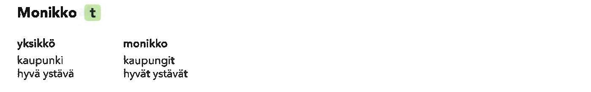{ loading=lazy decoding=async width="1409" height="221" }](../assets/grammar/plural/sm1-p04-009.png)

<figcaption>Suomen mestari 1 · s. 313</figcaption>
</figure>

<h3>i-monikko: monikkovartalo</h3>

<figure class="grammar-image" markdown="1">

[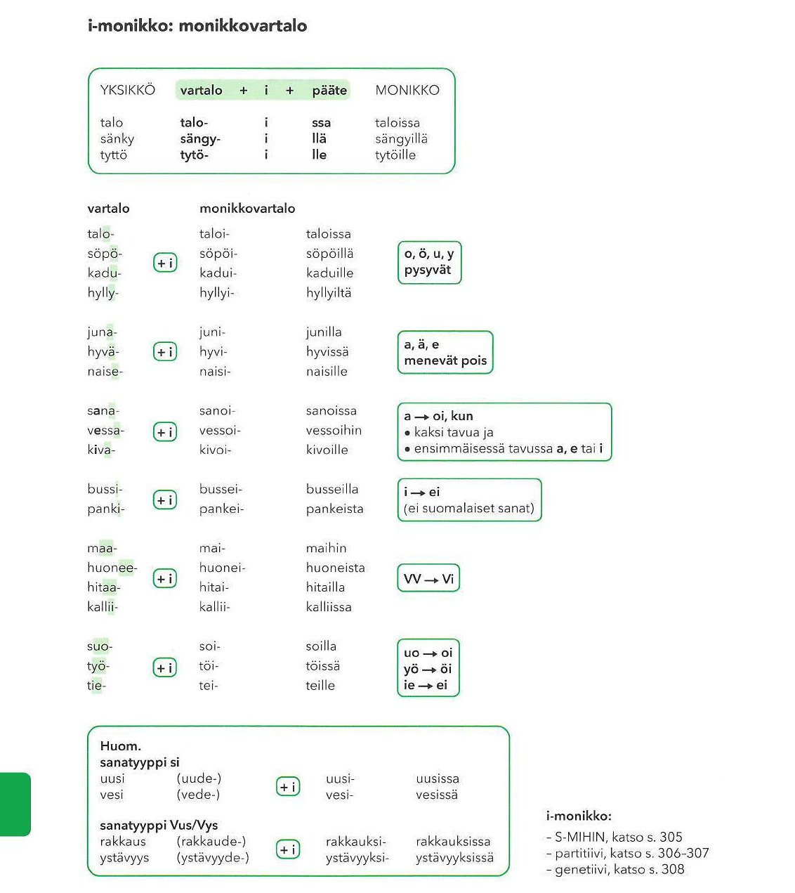{ loading=lazy decoding=async width="1132" height="1271" }](../assets/grammar/plural/sm2-p06-060.png)

<figcaption>Suomen mestari 2 · s. 302</figcaption>
</figure>

<h3>Pitkät sanat monikossa</h3>

<figure class="grammar-image" markdown="1">

[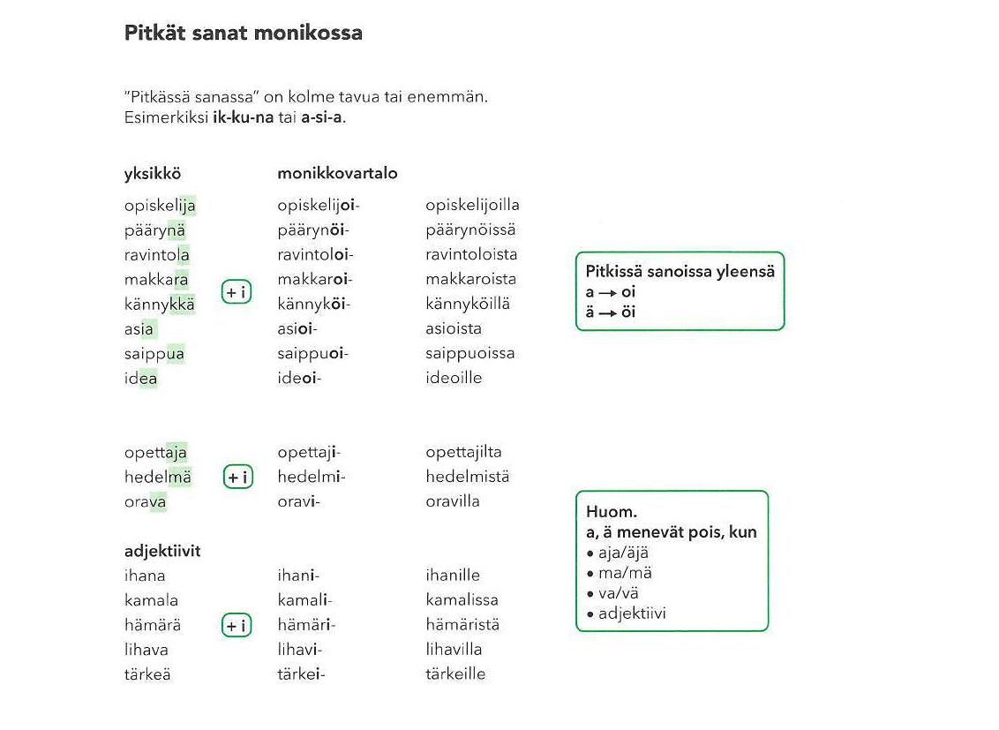{ loading=lazy decoding=async width="1132" height="827" }](../assets/grammar/plural/sm2-p07-061.png)

<figcaption>Suomen mestari 2 · s. 303</figcaption>
</figure>

## Падежи {#cases}

<h3>Partitiivin muodostus</h3>

<figure class="grammar-image" markdown="1">

[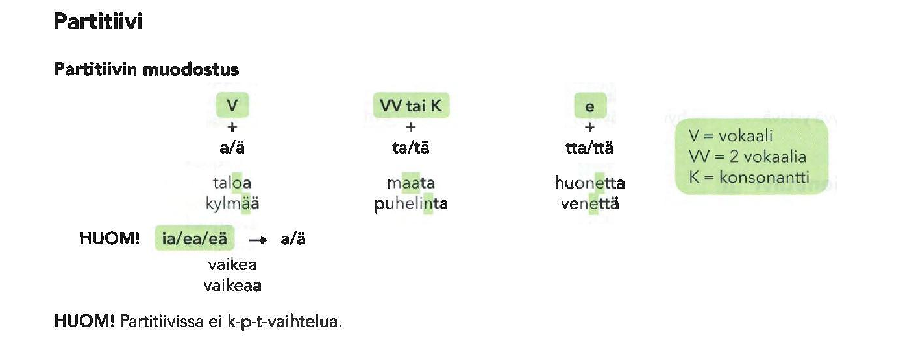{ loading=lazy decoding=async width="1391" height="531" }](../assets/grammar/cases/sm1-p05-012.png)

<figcaption>Suomen mestari 1 · s. 314</figcaption>
</figure>

<h3>Partitiivi: monikon muodostus</h3>

<figure class="grammar-image" markdown="1">

[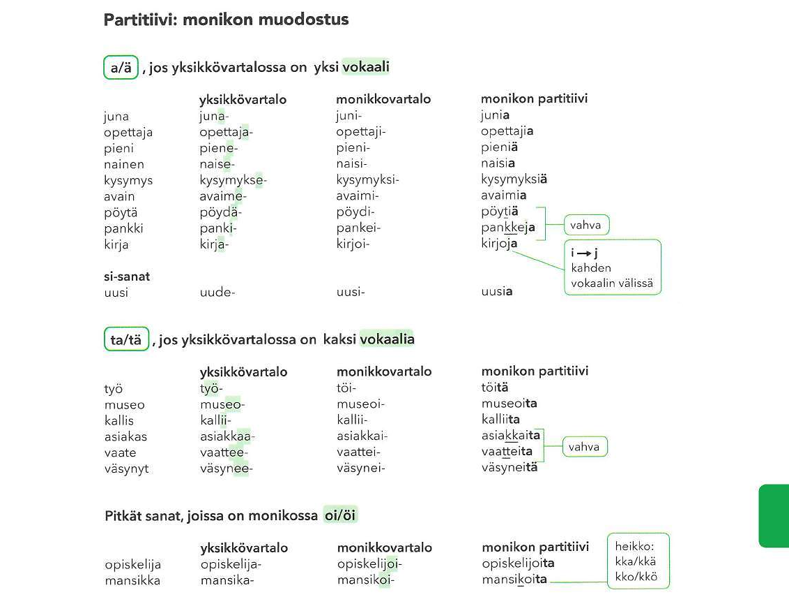{ loading=lazy decoding=async width="1132" height="865" }](../assets/grammar/cases/sm2-p11-069.png)

<figcaption>Suomen mestari 2 · s. 307</figcaption>
</figure>

<h3>Partitiivi: yksikön käyttö</h3>

<figure class="grammar-image" markdown="1">

[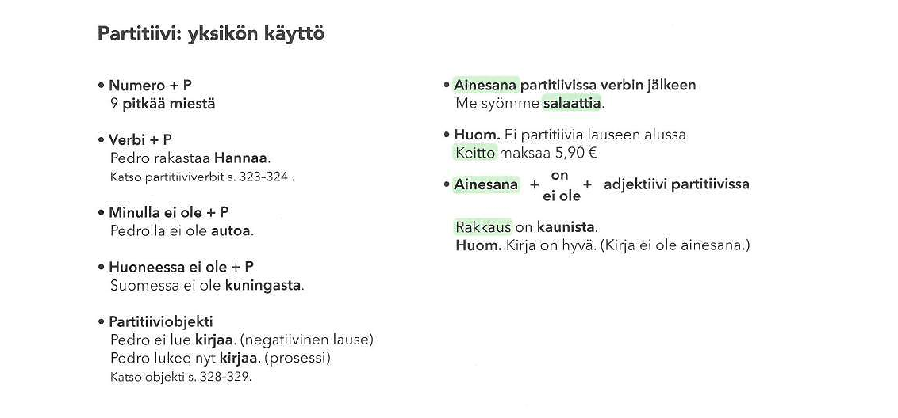{ loading=lazy decoding=async width="1132" height="528" }](../assets/grammar/cases/sm2-p10-066.png)

<figcaption>Suomen mestari 2 · s. 306</figcaption>
</figure>

<h3>Partitiivi: monikon käyttö</h3>

<figure class="grammar-image" markdown="1">

[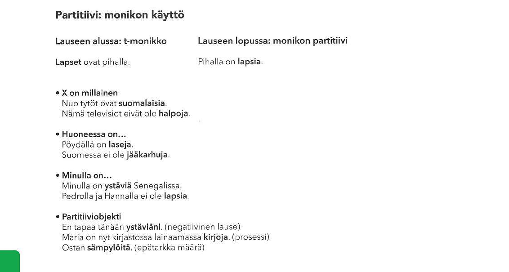{ loading=lazy decoding=async width="1132" height="605" }](../assets/grammar/cases/sm2-p10-067.png)

<figcaption>Suomen mestari 2 · s. 306</figcaption>
</figure>

<h3>Genetiivi</h3>

<figure class="grammar-image" markdown="1">

[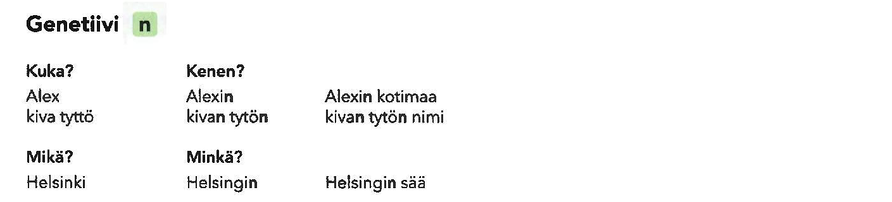{ loading=lazy decoding=async width="1409" height="320" }](../assets/grammar/cases/sm1-p04-010.png)

<figcaption>Suomen mestari 1 · s. 313</figcaption>
</figure>

<h3>Genetiivi: käyttö</h3>

<figure class="grammar-image" markdown="1">

[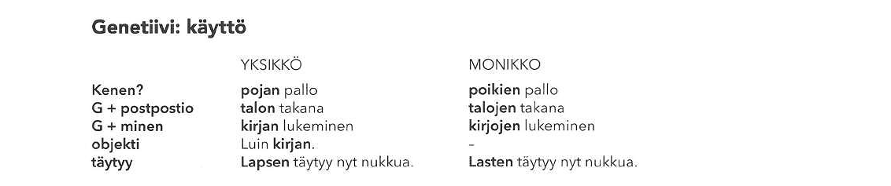{ loading=lazy decoding=async width="1132" height="237" }](../assets/grammar/cases/sm2-p12-070.png)

<figcaption>Suomen mestari 2 · s. 308</figcaption>
</figure>

<h3>Genetiivi: monikon muodostus</h3>

<figure class="grammar-image" markdown="1">

[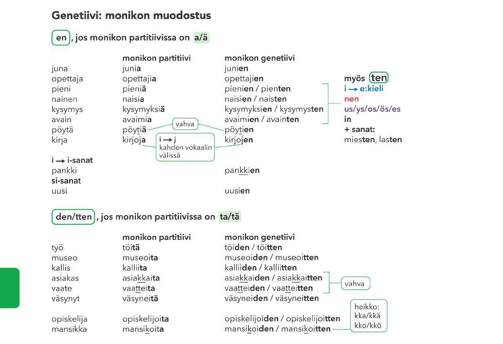{ loading=lazy decoding=async width="1132" height="774" }](../assets/grammar/cases/sm2-p12-072.png)

<figcaption>Suomen mestari 2 · s. 308</figcaption>
</figure>

<h3>Paikansijat</h3>

<figure class="grammar-image" markdown="1">

[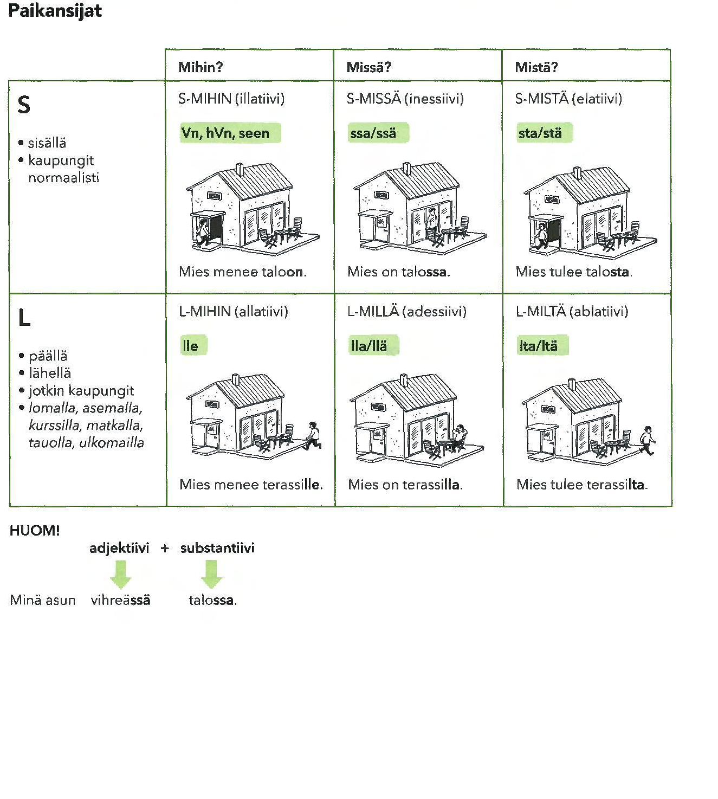{ loading=lazy decoding=async width="1325" height="1474" }](../assets/grammar/cases/sm1-p06-016.png)

<figcaption>Suomen mestari 1 · s. 315</figcaption>
</figure>

<h3>Paikansijat: yksikkö ja monikko</h3>

<figure class="grammar-image" markdown="1">

[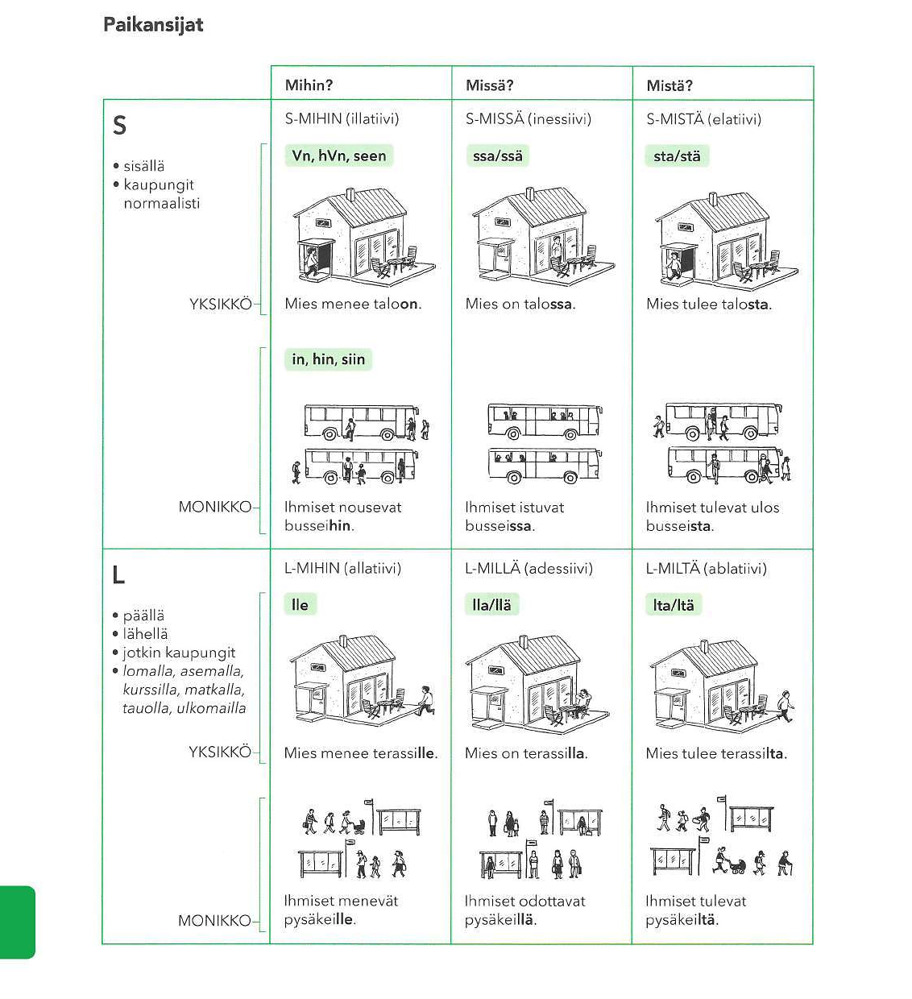{ loading=lazy decoding=async width="1132" height="1240" }](../assets/grammar/cases/sm2-p08-062.png)

<figcaption>Suomen mestari 2 · s. 304</figcaption>
</figure>

<h3>Ihminen: kenelle, kenellä, keneltä</h3>

<figure class="grammar-image" markdown="1">

[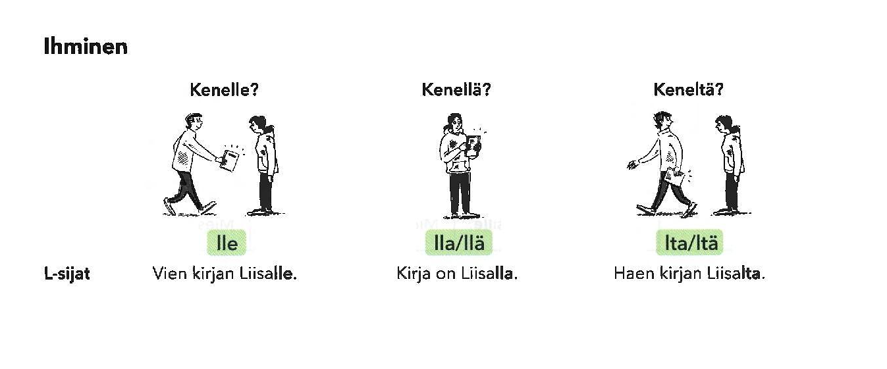{ loading=lazy decoding=async width="1347" height="561" }](../assets/grammar/cases/sm1-p07-018.png)

<figcaption>Suomen mestari 1 · s. 316</figcaption>
</figure>

<h3>S-MIHIN: illatiivi</h3>

<figure class="grammar-image" markdown="1">

[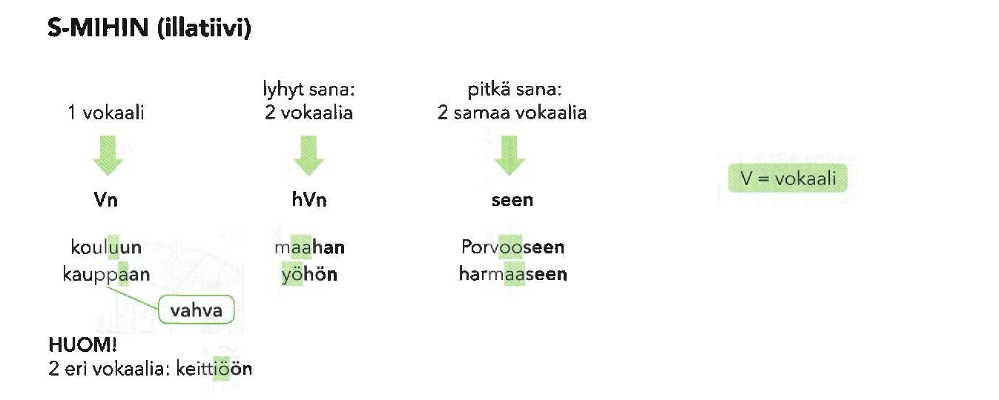{ loading=lazy decoding=async width="1347" height="540" }](../assets/grammar/cases/sm1-p07-017.png)

<figcaption>Suomen mestari 1 · s. 316</figcaption>
</figure>

<h3>S-MIHIN: illatiivi, monikko</h3>

<figure class="grammar-image" markdown="1">

[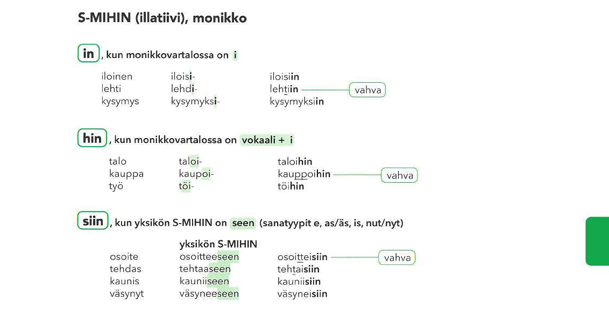{ loading=lazy decoding=async width="1132" height="575" }](../assets/grammar/cases/sm2-p09-065.png)

<figcaption>Suomen mestari 2 · s. 305</figcaption>
</figure>

## Местоимения и указательные наречия {#pronouns}

<h3>Persoonapronominit</h3>

<figure class="grammar-image" markdown="1">

[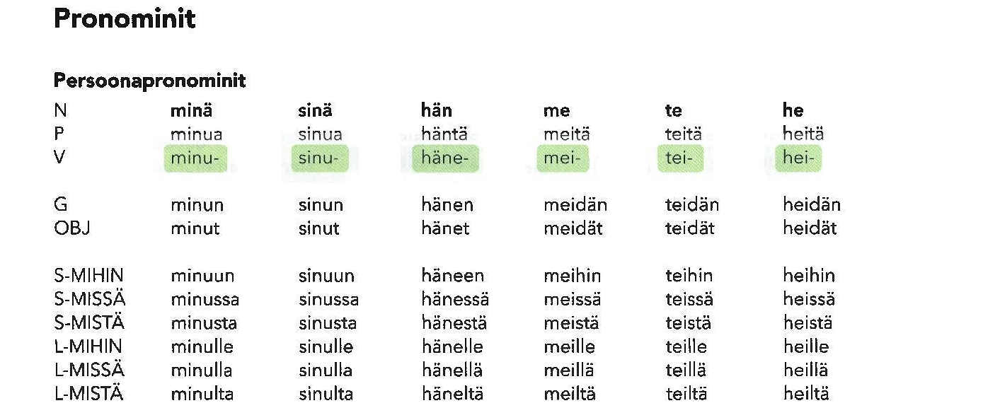{ loading=lazy decoding=async width="1413" height="594" }](../assets/grammar/pronouns/sm1-p08-019.png)

<figcaption>Suomen mestari 1 · s. 317</figcaption>
</figure>

<h3>Persoonapronominit: genetiivi ja possessiivisuffiksit</h3>

<figure class="grammar-image" markdown="1">

[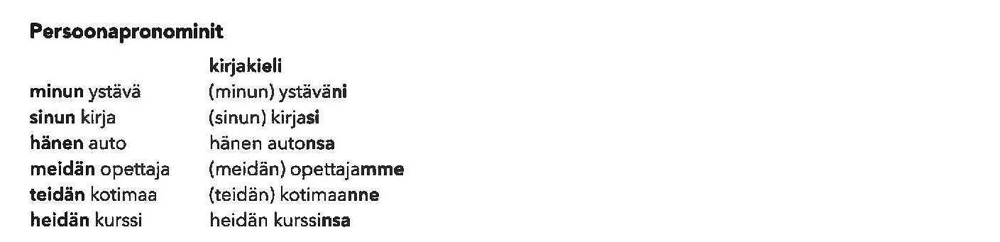{ loading=lazy decoding=async width="1409" height="341" }](../assets/grammar/pronouns/sm1-p04-011.png)

<figcaption>Suomen mestari 1 · s. 313</figcaption>
</figure>

<h3>Possessiivisuffiksit</h3>

<figure class="grammar-image" markdown="1">

[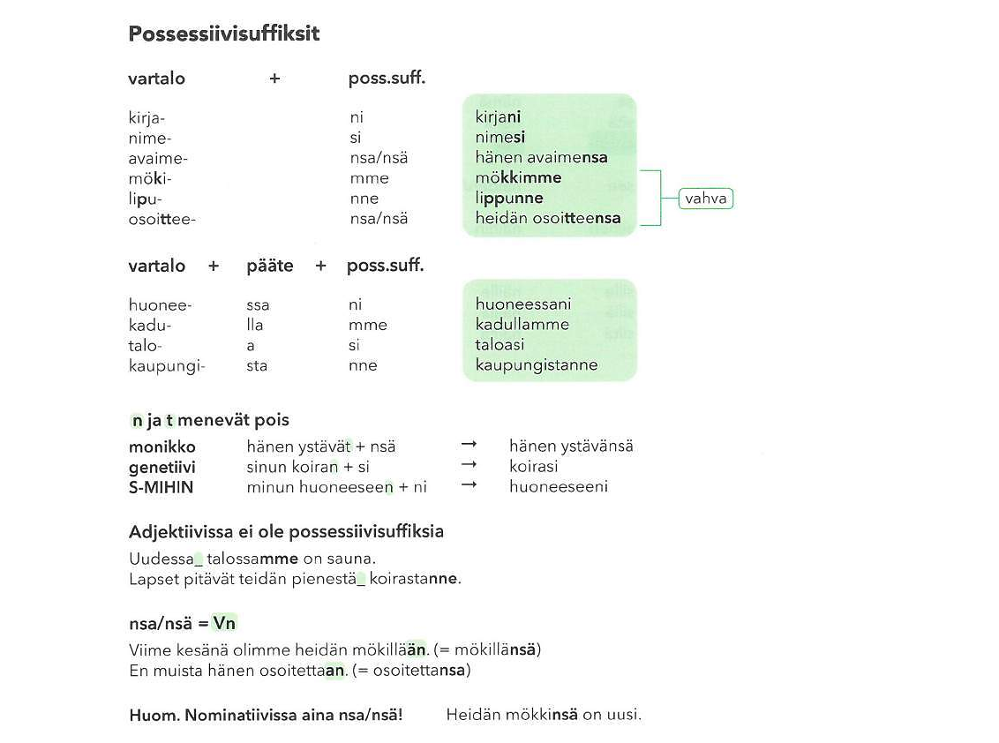{ loading=lazy decoding=async width="1132" height="842" }](../assets/grammar/pronouns/sm2-p13-073.png)

<figcaption>Suomen mestari 2 · s. 309</figcaption>
</figure>

<h3>Demonstratiivipronominit</h3>

<figure class="grammar-image" markdown="1">

[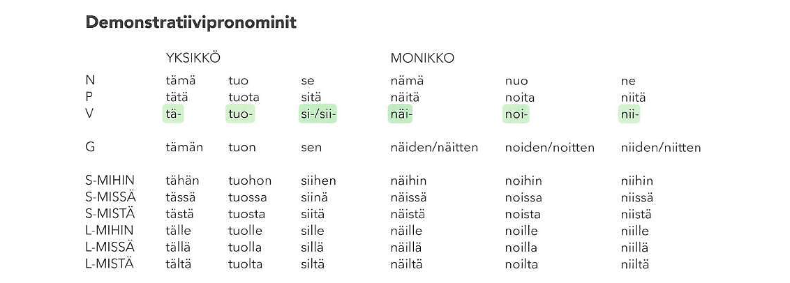{ loading=lazy decoding=async width="1132" height="406" }](../assets/grammar/pronouns/sm2-p14-075.png)

<figcaption>Suomen mestari 2 · s. 310</figcaption>
</figure>

<h3>Kysymyssanat: mikä ja kuka</h3>

<figure class="grammar-image" markdown="1">

[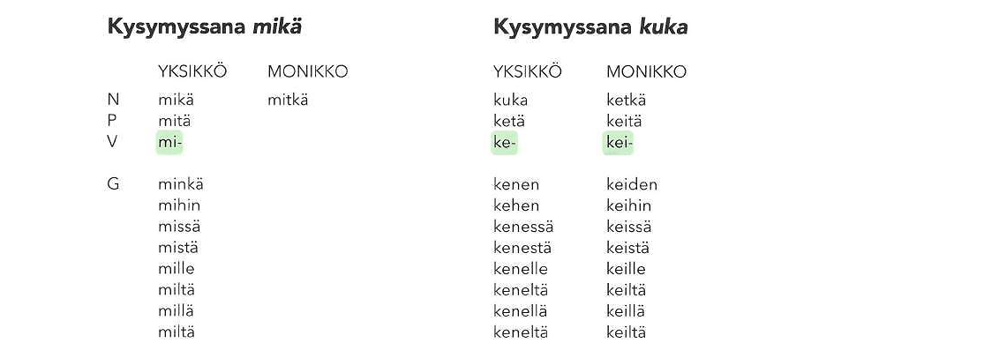{ loading=lazy decoding=async width="1132" height="406" }](../assets/grammar/pronouns/sm2-p14-076.png)

<figcaption>Suomen mestari 2 · s. 310</figcaption>
</figure>

<h3>Joka</h3>

<figure class="grammar-image" markdown="1">

[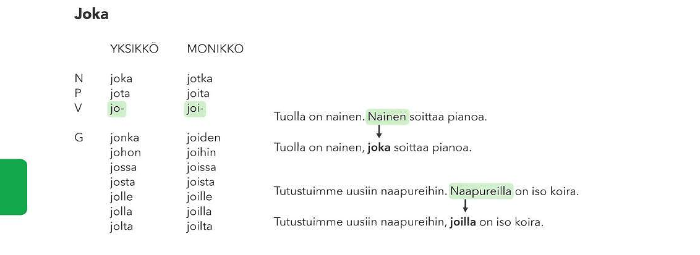{ loading=lazy decoding=async width="1132" height="413" }](../assets/grammar/pronouns/sm2-p14-077.png)

<figcaption>Suomen mestari 2 · s. 310</figcaption>
</figure>

<h3>Joku ja ei kukaan</h3>

<figure class="grammar-image" markdown="1">

[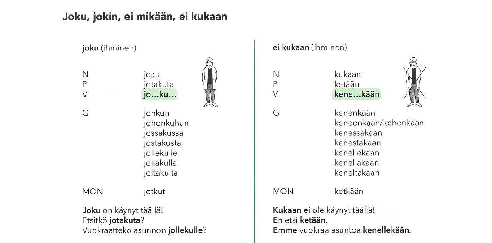{ loading=lazy decoding=async width="1132" height="559" }](../assets/grammar/pronouns/sm2-p15-078.png)

<figcaption>Suomen mestari 2 · s. 311</figcaption>
</figure>

<h3>Jokin ja ei mikään</h3>

<figure class="grammar-image" markdown="1">

[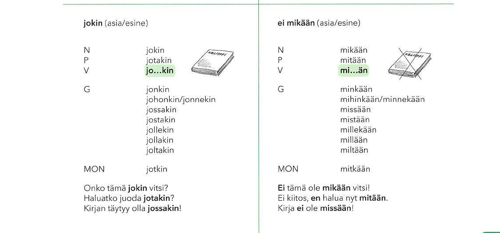{ loading=lazy decoding=async width="1132" height="528" }](../assets/grammar/pronouns/sm2-p15-079.png)

<figcaption>Suomen mestari 2 · s. 311</figcaption>
</figure>

<h3>Täällä, tuolla, siellä</h3>

<figure class="grammar-image" markdown="1">

[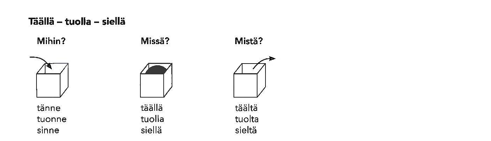{ loading=lazy decoding=async width="1413" height="406" }](../assets/grammar/pronouns/sm1-p08-021.png)

<figcaption>Suomen mestari 1 · s. 317</figcaption>
</figure>

<h3>Täällä, tuolla, siellä</h3>

<figure class="grammar-image" markdown="1">

[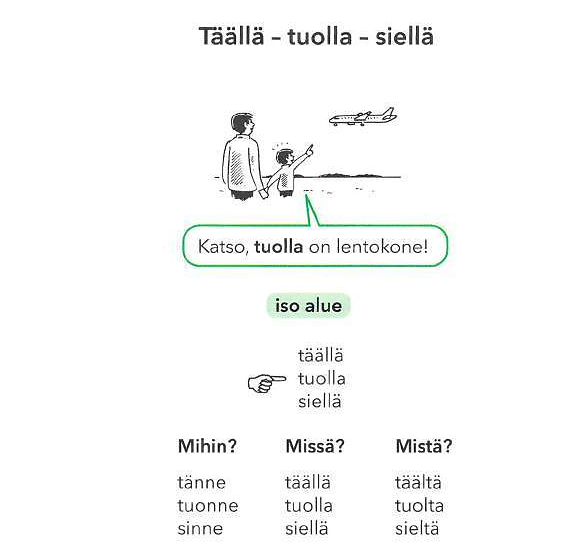{ loading=lazy decoding=async width="561" height="551" }](../assets/grammar/pronouns/sm2-p16-080.png)

<figcaption>Suomen mestari 2 · s. 312</figcaption>
</figure>

<h3>Tässä, tuossa, siinä</h3>

<figure class="grammar-image" markdown="1">

[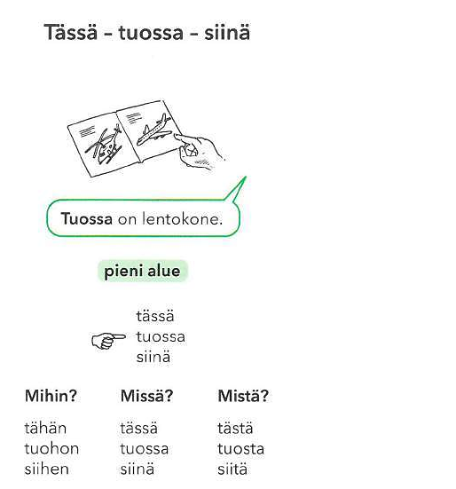{ loading=lazy decoding=async width="514" height="551" }](../assets/grammar/pronouns/sm2-p16-081.png)

<figcaption>Suomen mestari 2 · s. 312</figcaption>
</figure>

## Прилагательные и наречия {#adjectives}

<h3>Adjektiivien vertailu</h3>

<figure class="grammar-image" markdown="1">

[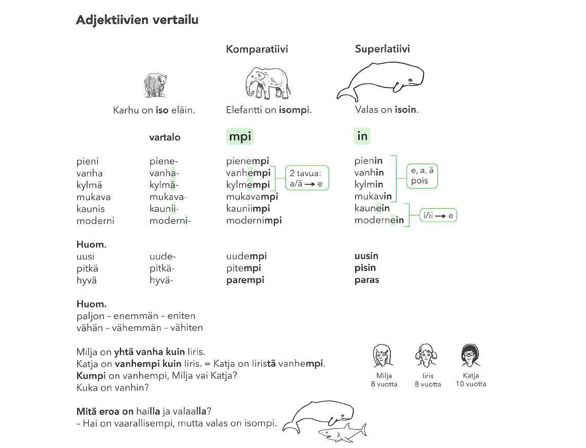{ loading=lazy decoding=async width="1132" height="865" }](../assets/grammar/adjectives/sm2-p17-082.png)

<figcaption>Suomen mestari 2 · s. 313</figcaption>
</figure>

<h3>Miten tekee? -sti</h3>

<figure class="grammar-image" markdown="1">

[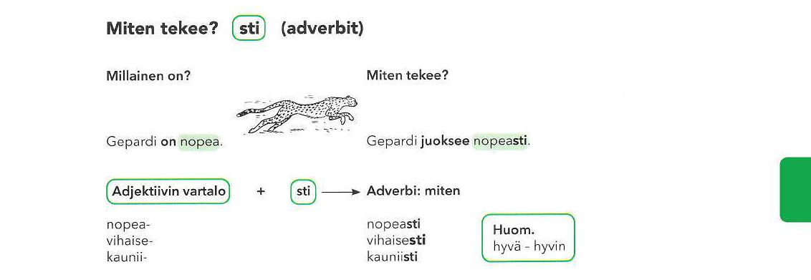{ loading=lazy decoding=async width="1132" height="391" }](../assets/grammar/adjectives/sm2-p17-083.png)

<figcaption>Suomen mestari 2 · s. 313</figcaption>
</figure>

## Verbityypit типы глаголов {#verbityypit}

<h3>Verbityypit 1–5</h3>

<figure class="grammar-image" markdown="1">

[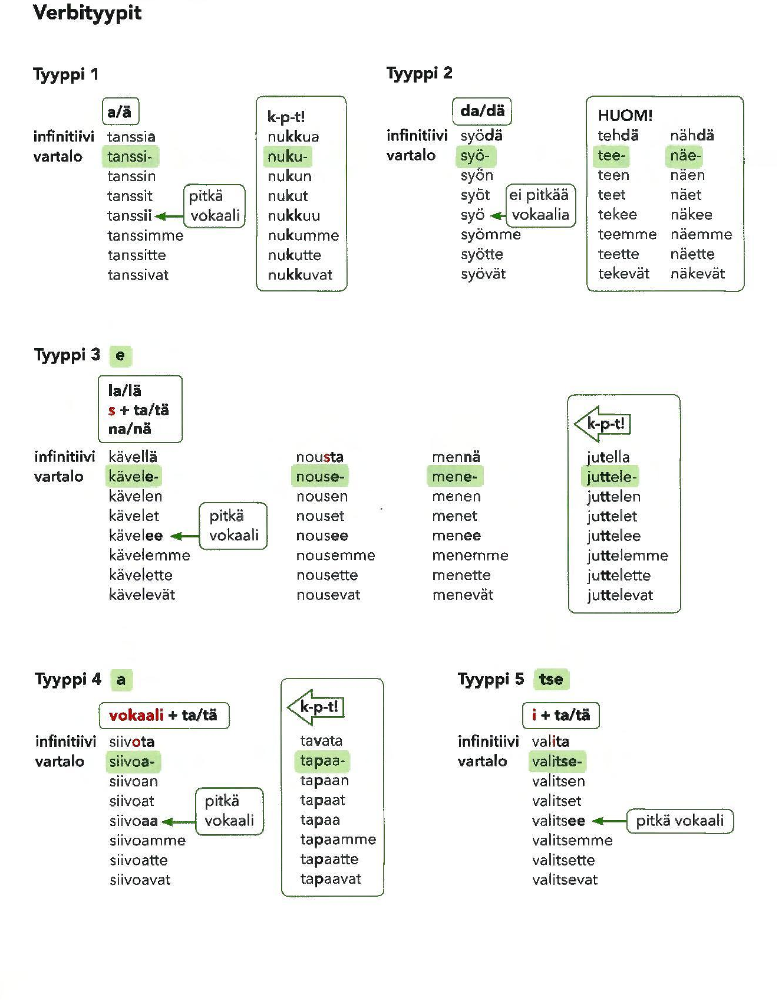{ loading=lazy decoding=async width="1327" height="1695" }](../assets/grammar/verbityypit/sm1-p11-028.png)

<figcaption>Suomen mestari 1 · s. 320</figcaption>
</figure>

<h3>Verbityypit 1–6</h3>

<figure class="grammar-image" markdown="1">

[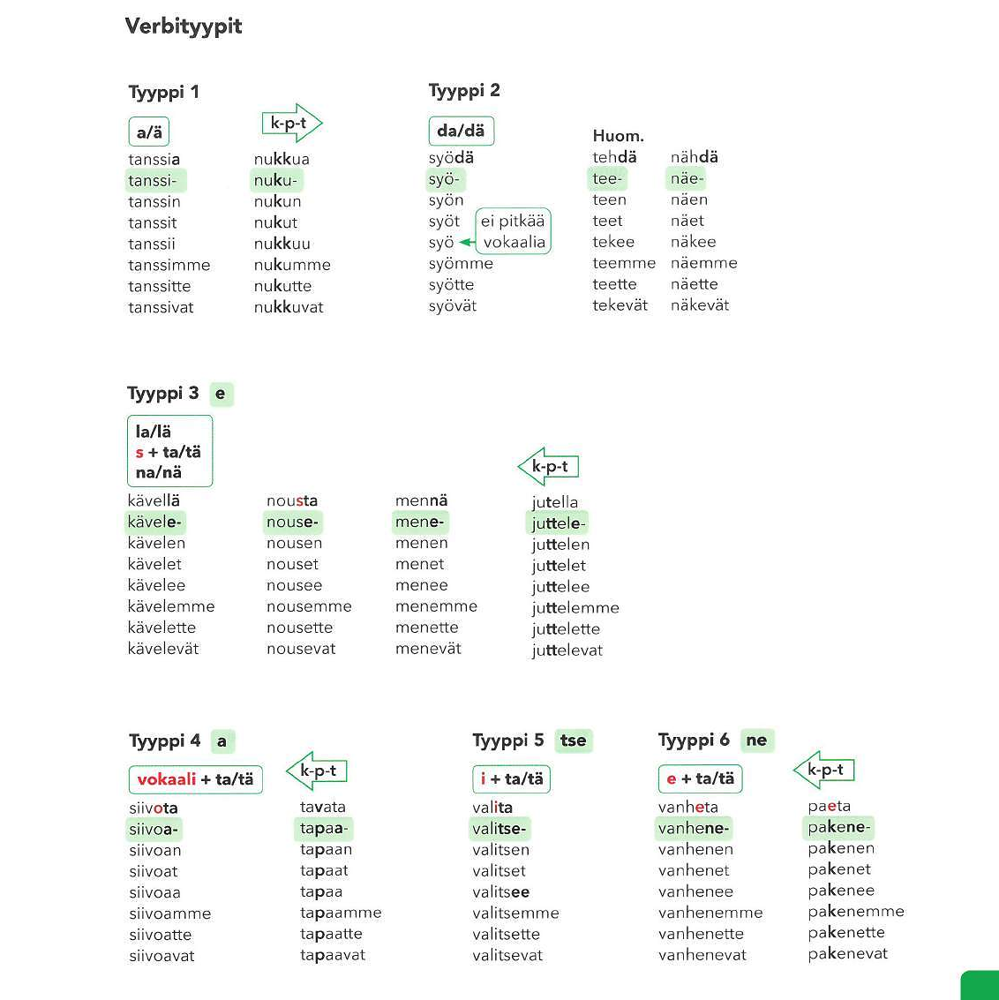{ loading=lazy decoding=async width="1132" height="1133" }](../assets/grammar/verbityypit/sm2-p19-086.png)

<figcaption>Suomen mestari 2 · s. 315</figcaption>
</figure>

## Aikamuodot времена и отрицание {#tenses}

<h3>Verbin persoonataivutus</h3>

<figure class="grammar-image" markdown="1">

[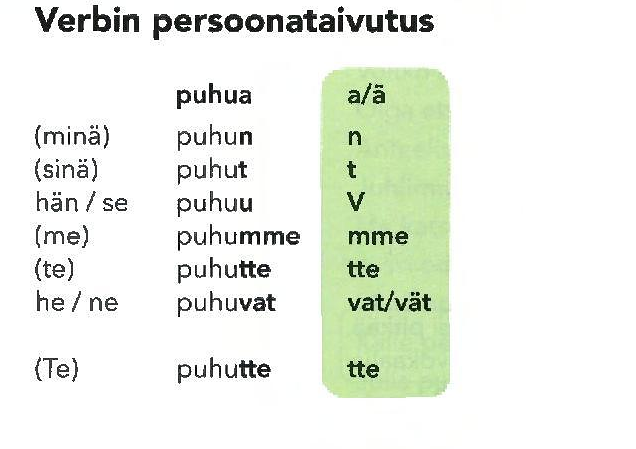{ loading=lazy decoding=async width="636" height="449" }](../assets/grammar/tenses/sm1-p10-024.png)

<figcaption>Suomen mestari 1 · s. 319</figcaption>
</figure>

<h3>Negatiivinen lause</h3>

<figure class="grammar-image" markdown="1">

[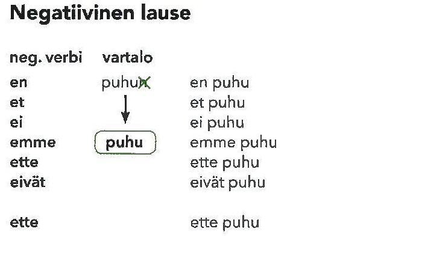{ loading=lazy decoding=async width="700" height="449" }](../assets/grammar/tenses/sm1-p10-025.png)

<figcaption>Suomen mestari 1 · s. 319</figcaption>
</figure>

<h3>Imperfekti</h3>

<figure class="grammar-image" markdown="1">

[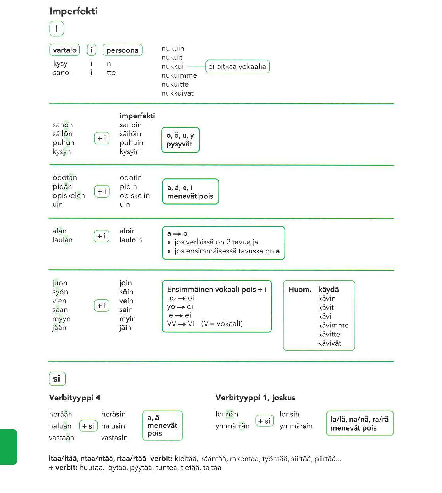{ loading=lazy decoding=async width="1132" height="1263" }](../assets/grammar/tenses/sm2-p20-087.png)

<figcaption>Suomen mestari 2 · s. 316</figcaption>
</figure>

<h3>Negatiivinen imperfekti</h3>

<figure class="grammar-image" markdown="1">

[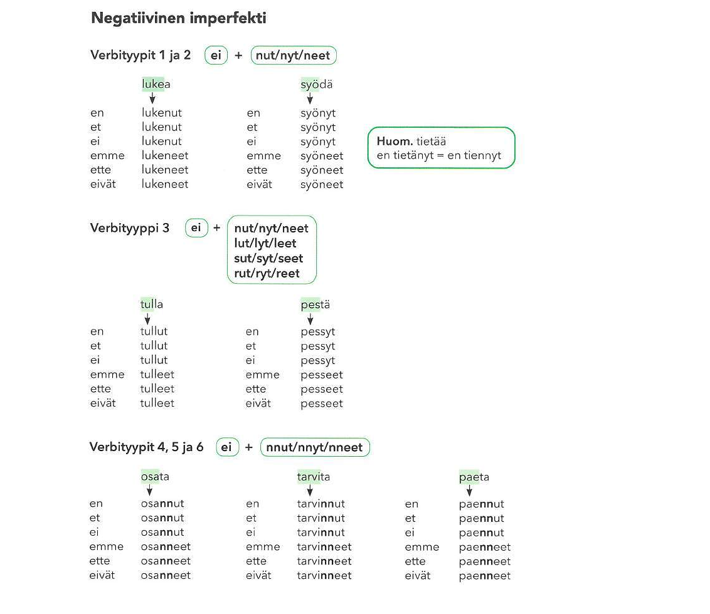{ loading=lazy decoding=async width="1132" height="980" }](../assets/grammar/tenses/sm2-p21-088.png)

<figcaption>Suomen mestari 2 · s. 317</figcaption>
</figure>

<h3>Perfekti</h3>

<figure class="grammar-image" markdown="1">

[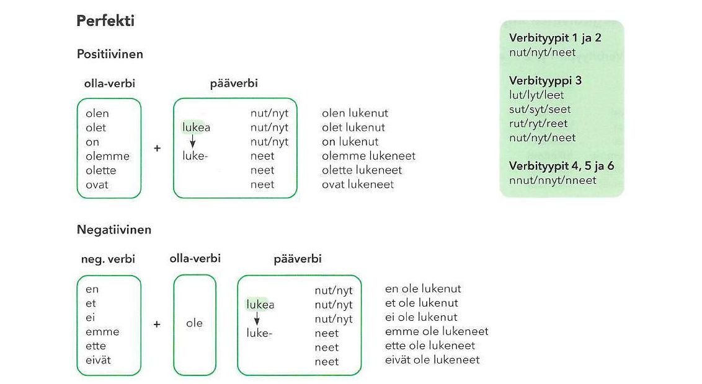{ loading=lazy decoding=async width="1132" height="620" }](../assets/grammar/tenses/sm2-p22-089.png)

<figcaption>Suomen mestari 2 · s. 318</figcaption>
</figure>

<h3>Pluskvamperfekti</h3>

<figure class="grammar-image" markdown="1">

[{ loading=lazy decoding=async width="1132" height="636" }](../assets/grammar/tenses/sm2-p22-090.png)

<figcaption>Suomen mestari 2 · s. 318</figcaption>
</figure>

<h3>Aikamuotojen käyttö</h3>

<figure class="grammar-image" markdown="1">

[{ loading=lazy decoding=async width="1132" height="1194" }](../assets/grammar/tenses/sm2-p23-091.png)

<figcaption>Suomen mestari 2 · s. 319</figcaption>
</figure>

## Повелительное наклонение и Mennään! {#imperative}

<h3>Käskymuoto: sinä-persoona</h3>

<figure class="grammar-image" markdown="1">

[{ loading=lazy decoding=async width="1344" height="419" }](../assets/grammar/imperative/sm1-p10-027.png)

<figcaption>Suomen mestari 1 · s. 319</figcaption>
</figure>

<h3>Mennään!</h3>

<figure class="grammar-image" markdown="1">

[{ loading=lazy decoding=async width="1132" height="567" }](../assets/grammar/imperative/sm2-p24-093.png)

<figcaption>Suomen mestari 2 · s. 320</figcaption>
</figure>

## Глагольные конструкции и minen {#infinitives}

<h3>Verbi + verbi</h3>

<figure class="grammar-image" markdown="1">

[{ loading=lazy decoding=async width="1344" height="619" }](../assets/grammar/infinitives/sm1-p10-026.png)

<figcaption>Suomen mestari 1 · s. 319</figcaption>
</figure>

<h3>Verbi + verbi: -maan, -massa, -masta</h3>

<figure class="grammar-image" markdown="1">

[{ loading=lazy decoding=async width="1132" height="834" }](../assets/grammar/infinitives/sm2-p25-094.png)

<figcaption>Suomen mestari 2 · s. 321</figcaption>
</figure>

<h3>minen-muoto</h3>

<figure class="grammar-image" markdown="1">

[{ loading=lazy decoding=async width="1132" height="918" }](../assets/grammar/infinitives/sm2-p26-095.png)

<figcaption>Suomen mestari 2 · s. 322</figcaption>
</figure>

## Rektio управление глаголов {#rektio}

<h3>Verbi + partitiivi</h3>

<figure class="grammar-image" markdown="1">

[{ loading=lazy decoding=async width="1391" height="538" }](../assets/grammar/rektio/sm1-p12-029.png)

<figcaption>Suomen mestari 1 · s. 321</figcaption>
</figure>

<h3>Verbi + -sta/-stä</h3>

<figure class="grammar-image" markdown="1">

[{ loading=lazy decoding=async width="1391" height="298" }](../assets/grammar/rektio/sm1-p12-030.png)

<figcaption>Suomen mestari 1 · s. 321</figcaption>
</figure>

<h3>Verbi + -lta/-ltä</h3>

<figure class="grammar-image" markdown="1">

[{ loading=lazy decoding=async width="1391" height="249" }](../assets/grammar/rektio/sm1-p12-031.png)

<figcaption>Suomen mestari 1 · s. 321</figcaption>
</figure>

<h3>Muut rektiot</h3>

<figure class="grammar-image" markdown="1">

[{ loading=lazy decoding=async width="1391" height="298" }](../assets/grammar/rektio/sm1-p12-032.png)

<figcaption>Suomen mestari 1 · s. 321</figcaption>
</figure>

<h3>Verbi + rektio 1</h3>

<figure class="grammar-image" markdown="1">

[{ loading=lazy decoding=async width="1132" height="1271" }](../assets/grammar/rektio/sm2-p27-096.png)

<figcaption>Suomen mestari 2 · s. 323</figcaption>
</figure>

<h3>Verbi + rektio 2</h3>

<figure class="grammar-image" markdown="1">

[{ loading=lazy decoding=async width="1132" height="1271" }](../assets/grammar/rektio/sm2-p28-097.png)

<figcaption>Suomen mestari 2 · s. 324</figcaption>
</figure>

<h3>Transitiivi- ja intransitiiviverbit</h3>

<figure class="grammar-image" markdown="1">

[{ loading=lazy decoding=async width="1132" height="1271" }](../assets/grammar/rektio/sm2-p29-098.png)

<figcaption>Suomen mestari 2 · s. 325</figcaption>
</figure>

## Lausetyypit типы предложений {#sentences}

<h3>Kysymyssanat, sanajärjestys ja ko/kö-kysymys</h3>

<figure class="grammar-image" markdown="1">

[{ loading=lazy decoding=async width="1314" height="844" }](../assets/grammar/sentences/sm1-p13-033.png)

<figcaption>Suomen mestari 1 · s. 322</figcaption>
</figure>

<h3>Minulla on…</h3>

<figure class="grammar-image" markdown="1">

[{ loading=lazy decoding=async width="1370" height="337" }](../assets/grammar/sentences/sm1-p13-034.png)

<figcaption>Suomen mestari 1 · s. 322</figcaption>
</figure>

<h3>Minulla on…</h3>

<figure class="grammar-image" markdown="1">

[{ loading=lazy decoding=async width="1132" height="306" }](../assets/grammar/sentences/sm2-p30-099.png)

<figcaption>Suomen mestari 2 · s. 326</figcaption>
</figure>

<h3>Huoneessa on…</h3>

<figure class="grammar-image" markdown="1">

[{ loading=lazy decoding=async width="1370" height="298" }](../assets/grammar/sentences/sm1-p13-035.png)

<figcaption>Suomen mestari 1 · s. 322</figcaption>
</figure>

<h3>Huoneessa on…</h3>

<figure class="grammar-image" markdown="1">

[{ loading=lazy decoding=async width="1132" height="252" }](../assets/grammar/sentences/sm2-p30-100.png)

<figcaption>Suomen mestari 2 · s. 326</figcaption>
</figure>

<h3>Minun täytyy…</h3>

<figure class="grammar-image" markdown="1">

[{ loading=lazy decoding=async width="1132" height="191" }](../assets/grammar/sentences/sm2-p30-101.png)

<figcaption>Suomen mestari 2 · s. 326</figcaption>
</figure>

<h3>On hauskaa…</h3>

<figure class="grammar-image" markdown="1">

[{ loading=lazy decoding=async width="1370" height="188" }](../assets/grammar/sentences/sm1-p13-036.png)

<figcaption>Suomen mestari 1 · s. 322</figcaption>
</figure>

<h3>X on millainen</h3>

<figure class="grammar-image" markdown="1">

[{ loading=lazy decoding=async width="1132" height="750" }](../assets/grammar/sentences/sm2-p31-103.png)

<figcaption>Suomen mestari 2 · s. 327</figcaption>
</figure>

## Objekti дополнение {#object}

<h3>Objekti: genetiivi, partitiivi ja monikko</h3>

<figure class="grammar-image" markdown="1">

[{ loading=lazy decoding=async width="1405" height="747" }](../assets/grammar/object/sm1-p14-037.png)

<figcaption>Suomen mestari 1 · s. 323</figcaption>
</figure>

<h3>Objektin käyttö: totaaliobjekti ja partitiiviobjekti</h3>

<figure class="grammar-image" markdown="1">

[{ loading=lazy decoding=async width="1132" height="796" }](../assets/grammar/object/sm2-p32-104.png)

<figcaption>Suomen mestari 2 · s. 328</figcaption>
</figure>

<h3>Objektin muodot</h3>

<figure class="grammar-image" markdown="1">

[{ loading=lazy decoding=async width="1132" height="880" }](../assets/grammar/object/sm2-p33-105.png)

<figcaption>Suomen mestari 2 · s. 329</figcaption>
</figure>

## Послелоги и предлоги {#postpositions}

<h3>Postpositiot ja prepositiot</h3>

<figure class="grammar-image" markdown="1">

[{ loading=lazy decoding=async width="1405" height="757" }](../assets/grammar/postpositions/sm1-p14-038.png)

<figcaption>Suomen mestari 1 · s. 323</figcaption>
</figure>

<h3>Postpositiot</h3>

<figure class="grammar-image" markdown="1">

[{ loading=lazy decoding=async width="1132" height="712" }](../assets/grammar/postpositions/sm2-p34-106.png)

<figcaption>Suomen mestari 2 · s. 330</figcaption>
</figure>

<h3>Prepositiot</h3>

<figure class="grammar-image" markdown="1">

[{ loading=lazy decoding=async width="1132" height="176" }](../assets/grammar/postpositions/sm2-p34-107.png)

<figcaption>Suomen mestari 2 · s. 330</figcaption>
</figure>

## Время, даты и порядковые числительные {#time}

<h3>Kello ja Monelta?</h3>

<figure class="grammar-image" markdown="1">

[{ loading=lazy decoding=async width="1339" height="1120" }](../assets/grammar/time/sm1-p15-039.png)

<figcaption>Suomen mestari 1 · s. 324</figcaption>
</figure>

<h3>Viikonpäivät</h3>

<figure class="grammar-image" markdown="1">

[{ loading=lazy decoding=async width="741" height="525" }](../assets/grammar/time/sm1-p15-040.png)

<figcaption>Suomen mestari 1 · s. 324</figcaption>
</figure>

<h3>Vuorokaudenajat</h3>

<figure class="grammar-image" markdown="1">

[{ loading=lazy decoding=async width="641" height="525" }](../assets/grammar/time/sm1-p15-041.png)

<figcaption>Suomen mestari 1 · s. 324</figcaption>
</figure>

<h3>Kuukaudet</h3>

<figure class="grammar-image" markdown="1">

[{ loading=lazy decoding=async width="597" height="538" }](../assets/grammar/time/sm1-p16-042.png)

<figcaption>Suomen mestari 1 · s. 325</figcaption>
</figure>

<h3>Vuodenajat</h3>

<figure class="grammar-image" markdown="1">

[{ loading=lazy decoding=async width="789" height="269" }](../assets/grammar/time/sm1-p16-043.png)

<figcaption>Suomen mestari 1 · s. 325</figcaption>
</figure>

<h3>Päiväys</h3>

<figure class="grammar-image" markdown="1">

[{ loading=lazy decoding=async width="1394" height="288" }](../assets/grammar/time/sm1-p16-044.png)

<figcaption>Suomen mestari 1 · s. 325</figcaption>
</figure>

<h3>Järjestysluvut</h3>

<figure class="grammar-image" markdown="1">

[{ loading=lazy decoding=async width="1394" height="517" }](../assets/grammar/time/sm1-p16-045.png)

<figcaption>Suomen mestari 1 · s. 325</figcaption>
</figure>

## Puhekieli разговорный язык {#spoken}

<h3>Kirjakieli ja puhekieli</h3>

<figure class="grammar-image" markdown="1">

[{ loading=lazy decoding=async width="1335" height="715" }](../assets/grammar/spoken/sm1-p17-046.png)

<figcaption>Suomen mestari 1 · s. 326</figcaption>
</figure>

<h3>Numerot puhekielessä</h3>

<figure class="grammar-image" markdown="1">

[{ loading=lazy decoding=async width="1335" height="1014" }](../assets/grammar/spoken/sm1-p17-047.png)

<figcaption>Suomen mestari 1 · s. 326</figcaption>
</figure>

<h3>Persoonapronominit puhekielessä</h3>

<figure class="grammar-image" markdown="1">

[{ loading=lazy decoding=async width="1378" height="1321" }](../assets/grammar/spoken/sm1-p18-048.png)

<figcaption>Suomen mestari 1 · s. 327</figcaption>
</figure>

<h3>Ks-kysymys</h3>

<figure class="grammar-image" markdown="1">

[{ loading=lazy decoding=async width="1378" height="410" }](../assets/grammar/spoken/sm1-p18-049.png)

<figcaption>Suomen mestari 1 · s. 327</figcaption>
</figure>

<h3>Verbit puhekielessä</h3>

<figure class="grammar-image" markdown="1">

[{ loading=lazy decoding=async width="1346" height="971" }](../assets/grammar/spoken/sm1-p19-050.png)

<figcaption>Suomen mestari 1 · s. 328</figcaption>
</figure>

<h3>Pikkusanat puhekielessä</h3>

<figure class="grammar-image" markdown="1">

[{ loading=lazy decoding=async width="1346" height="634" }](../assets/grammar/spoken/sm1-p19-051.png)

<figcaption>Suomen mestari 1 · s. 328</figcaption>
</figure>

